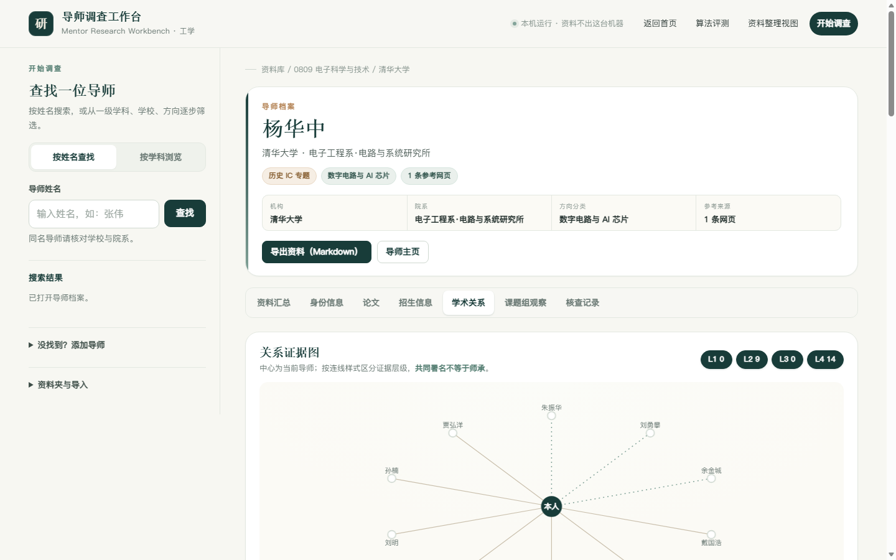
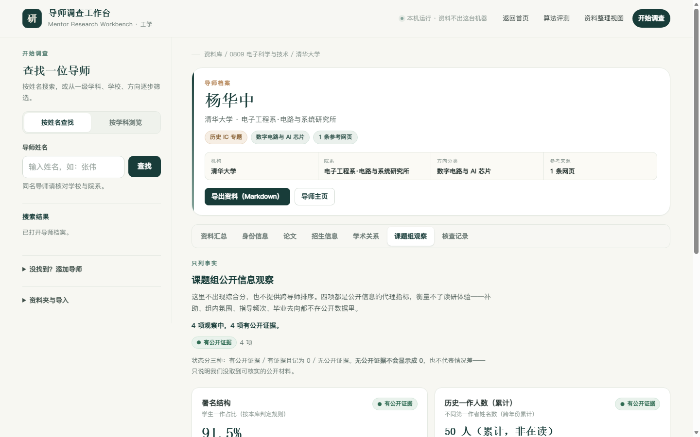
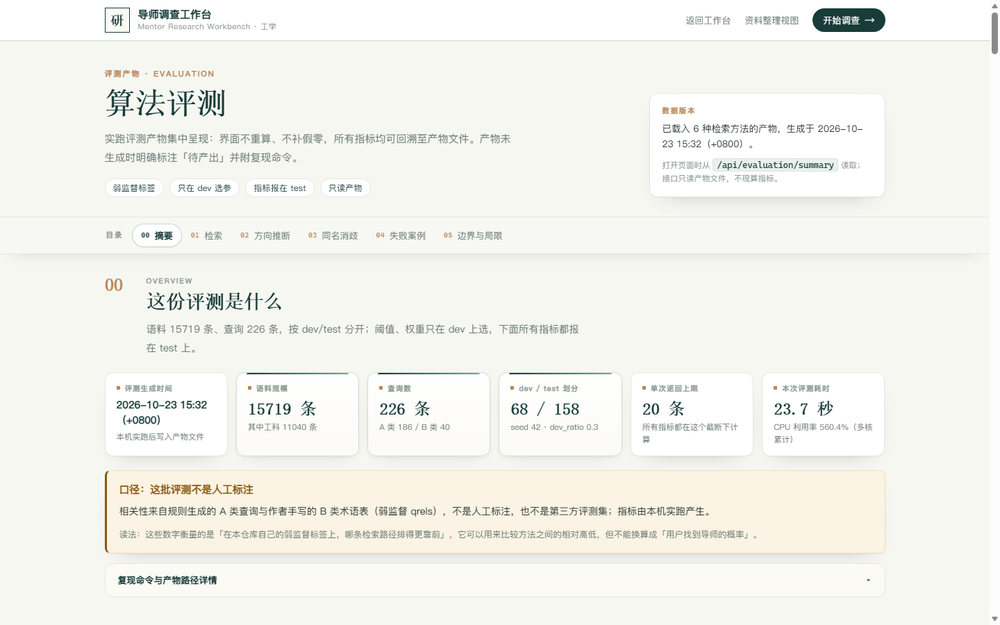
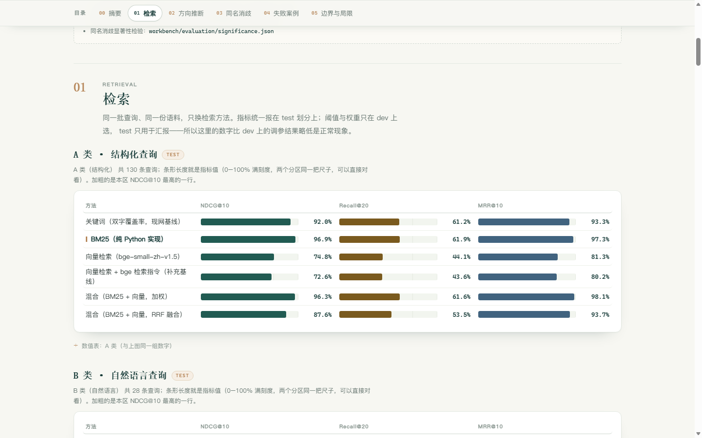

# 导师调查工作台（工学）

[](LICENSE)
[](LICENSE-DATA)
[](workbench/requirements.txt)
[](workbench/tests)
[](CHANGELOG.md)
[](SECURITY.md)
[](CONTRIBUTING.md)

这是一个面向工科学生的**本地导师调查工作台**。输入姓名后可在同名候选中核对学校与院系；也可依次选择一级学科、高校、方向和导师。选定身份后，集中查看公开来源、论文线索和学术关系网，补充证据、记录人工核查状态并导出调查记录。

与单纯的数据收纳项目相比，工作台多做两件事：**分析导师之间的关系**（四级证据分层，见下），以及给出**「课题组公开信息观察」**——四个维度各自列公开可核验的事实，不输出综合分、不加权、不排名，每个维度可点开看依据，并明确写出它不衡量什么。原有的开源中文向量检索保留在资料整理视图。

## 界面

> 以下为真实运行截图（1440×900）。首页右侧的产品预览与其中的姓名、分数是**虚构演示数据**，界面已标注；档案与评测图来自公开来源记录与真实评测产物。设计规范（颜色、字号、组件、断点、可访问性）见 [docs/DESIGN.md](docs/DESIGN.md)。

| 首页门户 | 导师档案 |
|:--:|:--:|
|  |  |
| **公开来源证据**（状态为文字胶囊，不靠颜色） | **学术关系证据图**（仅绘制有证据的关联） |
|  |  |
| **课题组公开信息观察**（四维事实，无综合分） | **算法评测看板**（数字来自产物） |
|  |  |



## 一键启动

双击根目录的 **`启动.cmd`**（英文系统用 `start.cmd`，内容相同）即可：

1. 若没有 `.venv`，自动创建并安装依赖（首次需要联网，几分钟）；
2. 启动本地服务并等到健康检查通过（最多等 20 秒）；
3. 自动打开浏览器到 <http://127.0.0.1:8765/>。

停止：关闭弹出的 **Mentor Workbench Server** 窗口，或双击 **`停止.cmd`**（`stop.cmd`）。

脚本刻意写成**纯 ASCII**：`cmd.exe` 用 OEM 代码页解析 `.cmd`，把中文按 UTF-8 写进去会把行切坏（实测会出现 `'on.exe' 不是内部命令` 这类报错）。中文只留在**文件名**与文档里。

<details>
<summary>手动启动（等价命令）</summary>

```bat
.venv\Scripts\python.exe -m uvicorn workbench.app:app --host 127.0.0.1 --port 8765
```

首次准备环境：

```bat
py -3 -m venv .venv
.venv\Scripts\python.exe -m pip install -r workbench\requirements.txt
```
</details>

## 体积说明

工程**能跑起来所需的最小集合**与仓库体积是两回事，分开记：

| 项目 | 体积 | 说明 |
|:--|--:|:--|
| 纳入 git 的文件（640 个） | **约 109 MB** | 按 git blob 大小统计（与平台无关）；大头是数据本体，见下方明细 |
| `.git` | 约 67 MB | 历史提交 |
| `.venv` | 约 211 MB | 虚拟环境，可由 `requirements.txt` 重建 |
| `data/raw` | 约 890 MB | **抓取到的网页原文**，只在采集脚本里用；运行期不读它，已 gitignore |
| `.workbench-data/` | 约 400 MB | 运行期档案、页面缓存与嵌入模型，已 gitignore |

**108 MB 里最大的几个文件**（可用 `python tools/repo_size.py` 随时重测）：

| 文件 | 体积 | 是什么 |
|:--|--:|:--|
| `data/processed/mentor_ranked.json` | 34.1 MB | 历史集成电路专题的语料与文献计量 |
| `workbench/reference/admission_faculty.json` | 18.0 MB | 招生目录与院系对应 |
| `workbench/reference/engineering_scale_faculty.json` | 9.9 MB | 工学各学科名录快照 |
| `workbench/reference/research/dossiers.json.gz` | 5.2 MB | **逐人档案打包**（clone 后界面靠它才有论文与招生记录） |
| `workbench/reference/research_sources.json` | 3.6 MB | 来源登记表 |
| `workbench/reference/ai/direction_suggestions.json` | 3.4 MB | **AI 方向建议产物**（clone 后「AI 建议」区块靠它） |

> 上表前两列由 `workbench.tools.check_readme_badges` 自动校验（`--fix` 可就地改正）——
> 这几个数字曾经分别写着 414 个 / 90 MB / 56 MB，与实际差了一大截，而没有人会去更新它们。

**已做的瘦身**：删掉了可重生成的页面缓存与一次性侦察目录，释放 **372 MB**（`research-pages` 353 MB、`discipline-pages`、`enrichment-runs`、各 `.scratch_*`）。这些删掉后应用功能不变——档案数据在 `.workbench-data/public-research/`，与页面缓存是两回事，实测接口全部正常。

**保留未删**：`data/raw`（网页原文）是"数据可核验"的底稿，删了就无法回溯某条记录来自哪个页面；它已被 gitignore，不影响仓库体积。`.workbench-data/models/` 是语义检索的嵌入模型缓存，删掉会在首次检索时重新下载。
**范围：**默认只展示 **38 个工学一级学科**（2022 年目录 08 门类）；另有 79 个非工科学科的数据保留在库中、保留原 ID，可用界面「显示非工科」开关查看。原历史集成电路专题已按研究关键词归入 0809 电子科学与技术、0810 信息与通信工程、0812 计算机科学与技术等工学学科，不再单列「学科待核定」。

**课题组公开信息观察不衡量学术水平、指导质量、课题组氛围与读研体验，也不构成报考建议。**它不给综合分、不给权重、不做跨导师排名，只把**四个维度的事实各自列出来**：

- **署名结构**——学生一作占比。判定规则是「第一作者不是本校教师、且第一作者单位能匹配到本库内置的高校名单」，因此**这不是导师把一作让给学生的比例**；名单没覆盖的学校会被漏计，比例偏低而非偏高。
- **历史一作人数（累计，非在读）**——跨年份累加的不同第一作者姓名数。**不等于在读学生数，也不是课题组规模，不可横向比较。**
- **近三年可核实论文数**——只作为事实记录，不评价高低；数字小也可能只是我们没检索到。
- **信息公开度**——本人专属主页 / 研究方向 / 博导标注三项事实清单，不打分。

论文的期刊档次、引用影响力与头衔**不进入**这套观察。每个维度严格处于三种状态之一：有公开证据且值为 X、有公开证据且确为 0、**无公开证据**（记为 `unknown`，**绝不显示为 0**，也不折算成分数）。完整口径与边界见 [DISCLAIMER.md](DISCLAIMER.md) 第四节之二。

**关系分析按证据强度分四级：**L1 明确师承（全库仅 27 条，有公开表述或学位指导记录支持）／L2 共同指导·长期合作／L3 同门／L4 共同署名。**只有 L1 可视为师承；共同署名一律不推定为师承。**

**开源来源与致谢：**本项目的**导师调查方法论**参考了开源项目 **[Academic Detective · 学术侦探](https://github.com/yadnuses/Academic-Detective)**（MIT，官网 <https://www.academic-detective.top/>）的七步调查框架；`tools/skill_heuristics.py` 按原样调用其 `analysis.common_heuristics` 异常规则模块（通过 `ACADEMIC_SKILL_SCRIPTS` 环境变量指向其安装位置，未设置时安全跳过）。**本仓库未纳入该项目的任何代码**，工作台的调查档案、同名核对、课题组公开信息观察与关系分析均为本项目自行实现；工作台读入的同级目录 `academic-investigations/` 是该项目的产出，仅摘录其中的事实性内容，不继承其评分与评价。完整清单见 [《开源及第三方资源使用清单》](workbench/aic-submission/开源及第三方资源使用清单.md)。

**当前进度（2026-10-23）：**全库 **15,719 条**记录（工学 38 个一级学科 **11,082 条**、公开来源 **12,546 条**、涉及 **67 所**高校或机构），来源模块 **53 个**、离线快照 **201 份**。

**最想让人先看到的一条结论：38 个工学学科的最大单一机构占比现已全部低于 60%。**

为什么要在意这个数：如果某学科 90% 的记录来自同一所学校，学生在上面看到的"不同学校导师"其实是同校几位老师，**跨校比较是假的**。所以我们把"最大单一机构占比 < 60%"定成硬标准，逐学科执行、逐学科公示。

**这条标准曾经卡住我们自己，也曾经被我们自己误判。** 我们一度把兵器、纺织、林业写成"全国设点极少、属结构性限制"。后来把设点单位清单列出来逐个实测，事实是三个学科分别有 **12 / 11+ / 11 所**设点单位——真正的瓶颈是**公开逐人师资名录的可达率低**（能核验的只有 3/12、3/11、2/11）。补入可核验单位后三个学科全部达标。

**"我没找到入口"不等于"世界上没有入口"**，这条方法论错误连同正确做法都写进了 [技术报告](workbench/aic-submission/技术报告.md) 第五章。

> 下面的历史记录保留原样，不再改写——它们记录的是当时的真实状态与判断，包括后来被推翻的那些。

> **破零但未达标，两件事不混说**：上海交大仍占 82.7%，远高于 60%。
>
> **刻意放弃了一条更大的数据源**：大连理工「力学与航空航天学院」（id=1209，自报 **184 条**）用它能把总量做到 259 条、上海交大压到 24%。但该学院是**力学（0801）与航空宇航（0825）合设**，整体归入会把力学教师算进来，属弱归属——与 0838 拒绝"把全校博导名单归入公安技术"同一标准。**宁可要 13 条干净的，也不要 184 条混进来的。**
>
> **本轮查证（避免重复）**：兵器对口三校教师主页系统仍全部 SSL 失败；东北林业／南京林业／北京林业／东华／天津工业的 `faculty` 子域全部 SSL 失败；北航、南航系统可打开但**没有单位列表**。
>
> **前一轮**：四个单一机构学科同时破零（船舶 128 条 57.0% 达标、安全 78 条 55.1% 达标、生物医学工程 90 条、交通运输 60 条）。

> **做法**：先把**已确认可用**的校级教师主页系统（中南 `xklb.jsp` 学科列表、大连理工 `xylb.jsp` 单位列表）的全部学科/单位**枚举成一张对照表**，再拿 8 个单一机构学科去匹配——一次命中 4 个。**这比逐校试探高效得多**，也是这轮次最重要的方法论。
>
> **一个模块处理两套页面形态**：中南是学科级（锚文本即姓名），大连理工是单位级（卡片锚文本是「姓名单位：…职称：…个人主页」的拼接，姓名取「单位」之前——顺带保证职称不串进方向字段）。两者都只收指向个人主页的链接。
>
> **条数核对**：安全 35/35、交通 12/12、生物医学 31/31 与自报完全一致；船舶 73/75 差 2 行，如实保留。

> **中南大学学科列表至此用满五个学科**：冶金 1115→0806 达标、地质 1126→0818 破零、材料 1114→0805 达标、矿业 1127→0819 深化到 4 所、环境 1130→0830 达标。**一条可用系统带来的产出，超过前面十几轮逐个猜院系子站的总和。**
>
> **目标项 (2) 的收官账**：0806 冶金 53.7%、0805 材料 41.8%、0836 生物 49.2%、0828 农业 49.1%、0830 环境 51.0% —— **5 个达标**；0815 水利（8 个入口全灭）、0816 测绘（6 个入口全灭）、0832 食品（6 个入口全灭，江南大学是客户端渲染空壳）—— **3 个确认阻塞，证据已逐条写入文档**。

> **"学院列表"打开了第一个来源**：江苏大学教师主页系统的学院列表页直接标着「农业工程学院(33)」。江苏大学的农业工程是国家重点学科，作为 0828 的第二机构是合适的。
>
> **踩到一个"页数静默截断"的坑，值得所有人记**：我按「每页 12 条」推算 `totalpage=3`，只拿到 **17 人**；实际每页只有 6 人、共 6 页，改 `totalpage=6` 后得到 **32 人**。**page 数取小了不会报错，只会静默少人**——这类错误比抓不到更危险，因为它看起来是成功的。测试里专门加了断言「第 6 页存在且非空」。
>
> **前一轮**：0836 生物工程达标（151→236、76.8%→49.2%），大连理工的入口是**单位列表**、中南大学的是**学科列表**，两家长得像但入口不同。

> **两家"长得像"的系统其实不同**：大连理工提供**单位列表**（`xylb.jsp`），学科列表 `xklb.jsp` 在本校 **404**；中南大学恰好相反，只有学科列表。不能套用同一个模板。
>
> **卡片锚文本是拼接的**：「安利佳单位：生物工程学院职称：教授个人主页」。姓名取「单位」之前的汉字串——这顺带保证**职称不会串进方向字段**（红线 2），测试里专门断言姓名不含「单位/职称/个人主页/教授」。
>
> **上一轮我在同一页上抓错了容器**（抓到页脚导航：教务处／研究生院／科学技术研究院／教师发展中心）。本轮改成"找含 personal-homepage 链接的容器"，定位到 `div.jsy`，每页 12 张卡片。页面自报 87 条、实际解析 85 行，差 2 行如实保留在测试里。
>
> **前一轮**：0819 矿业深化到 4 所（292 条 / 37.7%），中南系统性学科列表四个学科全部用完。

> **中南大学这个通用杠杆四个学科全部用完**：冶金（1115）→ 0806 达标、地质（1126）→ 0818 破零、材料（1114）→ 0805 达标、矿业（1127）→ 0819 深化。四学科共用同一系统与同一套 `totalpage` 规则，说明**"先找可用系统、再按学科批量取"这条路径可复用**——这正是我从"逐个猜院系子站"切换过来后的主要收获。
>
> **条数核对如实记录**：矿业 101/101 与页面自报完全吻合；冶金 55/55 也吻合；地质 83/82 差 1、材料 172/173 差 1，两处差异都保留在测试里（断言下限 + 显式记录实际值），**不凑数**。
>
> **前一轮**：0805 材料达标（340→512、62.9%→41.8%）。

> **中南大学这个杠杆已用三个学科**：冶金（1115）→ 0806 达标、地质（1126）→ 0818 破零、材料（1114）→ 0805 达标。三学科共用同一系统与同一套 `totalpage` 规则，说明**"先找可用系统、再按学科批量取"这条路径是可复用的**；还剩矿业（1127，101 条）未用。
>
> **前两轮**：0818 地质**破零**（23→106，机构 1→2，中南大学 78.3% 仍偏斜——破零与达标是两件事）；0806 冶金**达标**（143→428，89.5%→53.7%，中间那轮"61.7% 未达标"的经过保留在文档里，说明**修分布不是一次加法，要看加完之后谁成了新的最大机构**）。
>
> **一个坑**：`totalpage` 是**请求参数**，传小了只会拿回首页。首探传 1 只看到 20 行，差点误判"这学科只有 20 人"。

> **前一轮：冶金工程已达标**——143→428（东北大学 230 + 中南大学 55），最大单一机构 **89.5% → 53.7%**，学科从 2 所变 4 所。中间那轮"改善但未达标（61.7%）"的经过保留在文档里，因为它说明**修分布不是一次加法，要看加完之后谁成了新的最大机构**。
>
> **通用杠杆**：`faculty.csu.edu.cn` 的「学科列表」按一级学科组织，已用它拿下冶金（1115，55 位）与地质（1126，83 位）；还有材料（1114，173 条）、矿业（1127，101 条）可用。
>
> **一个坑**：该系统的 `totalpage` 是**请求参数**，传小了只拿回首页。首探传 1 只看到 20 行，差点误判"这学科只有 20 人"。

> **中间那轮是"改善但未达标"，值得记下来**：先只加东北大学 230 位，北科大从 89.5% 降到 34.3%，**但东北大学自己成了最大机构（61.7%）**，差 1.7 个百分点。第二轮补中南大学 55 位才达标。**修分布不是一次加法，要看加完之后谁成了新的最大机构。**
>
> **中南大学这个来源是学科级的，不是弱归属**：`faculty.csu.edu.cn` 的「学科列表 → 工学 → 冶金工程」页面标题即「冶金工程教师列表」、自报「共55条」，我抓 3 页解析出 **55 行 / 55 个不同姓名，与自报数完全吻合**。这与 0838 拒绝「全校博导名单归入公安技术」是同一标准。
>
> **新发现一个通用杠杆**：该系统按一级学科组织，同一入口下还有材料科学与工程（id=1114）、地质资源与地质工程（id=1126）、矿业工程（id=1127）、动力工程及工程热物理——**0818 地质（现仅 1 所）可以直接用它破零**。这比逐个猜院系子站高效得多，后续轮次优先用它。

> **顺带修掉一个会让"整页 0 行"的采集器缺陷（这是本轮最重要的发现）**：`fetch()` 原先把服务端声明的编码用 chardet 的猜测覆盖掉。东北大学这页声明 **UTF-8**，chardet 却猜成 `ptcp154`（西里尔文），整页变乱码、中文姓名全部匹配失败——解析器在**明明有 230 人**的页面上返回 **0 行**，第一次合并 `added: 0` 就是这个原因。已改为优先信任真实声明，声明缺失时依次试 UTF-8 → GB18030，并在"声明解出无汉字但字节含汉字"时回退重解；补了 4 个离线回归用例。**教训：「解析出 0 行」未必是页面没数据，也可能是解码错了。**

> **三处收录口径**：① 按**职称**三类各建一个 `SPECS`（教授 54／副教授 32／讲师 5），三类互不重叠；② **刻意不收「实验团队教师」（27 位）**——那是实验技术系列，与教学科研教师是不同岗位序列，混在一起会让口径失真；③ **收录规则可核实**：只收链接形如 `c<栏目>a<文章>/page.htm` 的锚点，这条规则同时排除了「下载区」这类栏目标签（第一版正是被它带进来 60 个假姓名）。
>
> **读到论文为零，要说清楚**：91 位全部读到简介（91/91 就绪），但**论文列表不在可解析的静态结构里**，因此「近三年公开论文」这一维度只能记为 `unknown`（无公开证据，不记为 0）。**这不影响公开信息观察其余三个维度，但意味着本学科的跨校比较只能到"署名结构／历史一作人数／信息公开度"这一层，不能比论文。**
>
> **方法经验**：先自己定位院系子站、确认页面真的"一人一行"，再写解析器——上一轮派代理盲抓时，北京化工大学「教师名录」是**系目录**（0 个详情页链接）、太原理工与浙江大学不可达，而先探后写一次命中。

**前一批（2026-10-15）：**修正一处 **93.2%** 的分布倾斜——**矿业工程 118→191**（中国矿业大学（北京）能源与矿业学院「教师列表」73 位）。学科变为 **3 所**：中国矿业大学（徐州）110（**57.6%**）、中国矿业大学（北京）73（38.2%）、江西理工大学 8（4.2%）。

> **为什么这是"另一所大学"**：本校域名 `cumtb.edu.cn`，徐州本部为 `cumt.edu.cn`，是两所独立设置的高校，不是"同一学校的不同学院"。
>
> **顺带修掉一个反复咬人的工程问题**：采集器原先要求**所有来源都成功**才写文件，任何无关来源抖动都会让整批被"保留原文件"的守卫挡住——本轮华科两个页面连续超时，这 73 条**三次**都没并进去。已加 `--only KEY[,KEY…]` 只采指定来源，且 subset 运行会**并入**已发布 supplement 而非替换（否则"只采一个来源"会被误判成灾难性缩水）。一次成功。
>
> 同时验证了上一轮的审计守卫生效：三次降级运行都没有改写 `added: 746 / failures: 0`，而是另存了 `last_degraded_run`。

**前一批（2026-10-15）：**修正全库最严重的一处分布倾斜——**机械工程 190→1096 条**，最大单一机构占比由 **96.3% 降到 30.1%**，学科变为 **8 所**。新增四所：西安交通大学 330 行、华中科技大学 232 位、大连理工大学 184 位、清华大学 160 位。分布为西安交大 30.1%、华科 21.2%、大连理工 16.8%、上海交大 16.7%、清华 14.8%——**五所强校量级相当，"修分布"到这里才第一次真正成立**。

> **三处收录口径，没有一处靠猜**：① **华科**名录按**拼音字母**分组（那是索引不是院系），院系取自每人 `/info/<columnId>/` 链接，并映射到学院自己的 10 个教研单位页、**用「与该单位页面的集合相等」验证映射**；也刻意没按单位各建一个 `SPECS`——11 位教师同时出现在两个单位页，逐单位建 spec 会让人重复出行。② **大连理工**只收个人主页在 `faculty.dlut.edu.cn` 上的 184 位，**这条规则可用链接本身验证**；约 37 位主页仍在学院旧版 IP 主机上的教师不收。③ **清华**只收「在职教师」，排除兼职／双聘／名誉／访问教授与教辅人员。
>
> 四家都**不提供研究方向字段**，故 906 位方向一律「方向待补」；但这四批人**都有可用的个人页**，`--enrich` 可据此补方向。

**前一批（2026-10-15）：**扩充**公安技术 14→101**（中国刑事警察学院「研究生导师」名录 87 位），该学科由 1 所变 2 所。同时按「至少重试 3 次 + 试 http/https」的标准**重新实测**了此前标记不可达的地质类院校：中国地质大学（武汉）及其两个学院、中国矿业大学资源学院、成都理工**https 与 http 全部失败**，因此先前结论成立、并非网络抖动所致；而公安类院校可达，这才有了那批来源。

> **公安技术这份来源的收录口径是刻意选择**：学校按 10 个教学单位公布全校导师，本模块只收与 0838 对应的四个技术类单位（刑事科学技术学院 34、公安信息技术与情报学院 25、公安基础教研部 16、警犬技术学院 12），**排除**通识与法学单位，以及侦查与反恐怖学院、经济犯罪侦查学院、禁毒与治安学院——后三个是**公安学（0306）**方向的侦查与治安院系，并进 0838 等于把另一个一级学科的人划过来。单位匹配用白名单（默认拒绝），新增栏目不会悄悄混入。
>
> **仍未解决的偏斜**：刑事警察学院占该学科 **86.1%**（87/101）。第三所候选已探明可达性（南京警察学院、四川警察学院首页可达；中国人民警察大学、郑州警察学院、广东警官学院不通），但还需按 0838 的具体技术院系逐一核对。

**前一批（2026-10-15）：**本轮解决**两处分布倾斜**。

① **控制科学与工程 149→474**（东北大学信息科学与工程学院 13 个研究所 123 位；浙江大学控制科学与工程学院 107 位；东南大学自动化学院 95 位）——该学科此前 149 条中华中科技大学独占 125 条（84%），其余 7 所合计仅 24 条，跨校比较实际不成立；接入后 **474 条 / 11 所**，最大单一机构占比降到 **26.4%**。

② **石油与天然气工程 164→758**（中国石油大学（华东）221 位；西南石油大学 271 位；东北石油大学 102 位）——该学科此前 164 条**全部来自中国石油大学（北京）一所**（100%）；接入三校后 **758 条 / 4 所**（西南石油 271／石油大学华东 221／石油大学北京 164／东北石油 102），最大单一机构占比降到 **35.8%**。

工学范围内条目 6,592→**7,511**；全库 12,148 条、公开来源 8,975 条、公开来源机构 48 个（接口实测）。

> **一处已修复的隐私缺口（值得记录）**：项目红线是「不收录邮箱与电话」，但公开前审计**只拦邮箱**，电话号码会一路发布出去。经独立复核确认：22 份来源快照里含 **43 个真实号码**（含 11 位手机），旧数据与 `reports/` 里另有 **73 处**带「联系电话：」标签的号码，测试文件本身也硬编码了 3 个。现已全部替换为「联系方式已隐去」（JSON 改写前后重新解析比对，结构与其余字段未变），并给审计**新增电话号码检查**：规则调准后为 **17 通过 / 0 阻塞**，改前那 43 处会确实命中。
>
> 调准过程本身也值得记：审计原本把 34 MB 的技术报告 **PDF 当文本读**，其压缩流随机命中 1620 处号码形态，足以让规则失去意义；同时朴素的号码正则会把 DOI 后缀（`10.1055/s-0039-1698837`）、页面 id（`gr.xjtu.edu.cn/0020220087`）与图片指纹误判成号码。现数字类扫描只读文本文件，并用边界断言排除这三类形态。

> **东北大学按研究所各建一个 `SPECS` 条目**：总览页只列 101 人，各研究所自己的名录页合计 123 人（电气自动化研究所一所就有 33 人），逐所更全，且能让每条记录带上所属研究所。实测各所之间**重名 0 人**。
>
> **两处"页面是壳"的排查经验（同类问题，可复用）**：
> - **东南大学自动化学院**：四个候选 `list.htm` 在服务端都是空壳（只有加载图与空列表），真实数据源是站内查询服务 `_wp3services/generalQuery`（响应体是 JSON，`Content-Type` 却写 `text/html`）。该服务的 `exField2` 装教师电话、`exField3` 装外部网址，模块用字段白名单**不申请**这两个字段，所以**联系方式在取数层就不存在**，而不是靠事后过滤——实测响应体 17,438 字符内 0 邮箱 0 电话。
> - **中国石油大学（华东）石油工程学院**：三个候选 URL 里两个还是同一份「师资概况」，页面上没有任何教师链接与分页标记；真实名单在页面额外加载的 `/_upload/tpl/07/a3/1955/template1955/js/json.js` 里——后缀是 `.js`，内容却是 `var jsonBox = [ {name, add, szm, dep, tutor, professor}, … ]` 数据。它是 JS 不是严格 JSON（键名可不带引号、单双引号混用、有尾随逗号），`json.loads` 直接失败。
>
> 共同结论：**页面是壳时，去看它加载了什么**。这两处都是 WebPlus 家族模板（`wp_nav`、`sub-nav`、`x-layout`、`/_wp3services/`）。
>
> **石油与天然气工程的覆盖缺口（如实记录）**：221 位覆盖学院全部 8 个研究所/中心，但**不等于全院人员**（学院师资概况自称教职工 217 人，而本名录含 38 位兼职与 1 位外院，口径不同、不可互相加减）；且该数据源**没有研究方向字段**，385 条方向全为「方向待补」，因此 0820 的跨校比较只能到**姓名/院系/职称**层面，**还不能到方向层面**。


> **东南大学这份来源值得记一笔**：四个候选 `list.htm` 在服务端**都是空壳**（只有加载图与空列表），名单由模板脚本异步取回；真实数据源是站内查询服务 `_wp3services/generalQuery`（响应体是 JSON，`Content-Type` 却写 `text/html`）。该服务的 `exField2` 装教师电话、`exField3` 装外部网址，模块用字段白名单**不申请**这两个字段，所以**联系方式在取数层就不存在**，而不是靠事后过滤——实测响应体 17,438 字符内 0 邮箱 0 电话。这套 WebPlus 结构在其它高校也常见，遇到"页面是壳"时可照此排查。
>
> **东北大学按研究所各建一个 `SPECS` 条目**：总览页只列 101 人，各研究所自己的名录页合计 123 人（电气自动化研究所一所就有 33 人），逐所更全，且能让每条记录带上所属研究所。实测各所之间**重名 0 人**。
>
> **刻意排除**：「按职称」「博导／硕导」名录是同一批人的另一种切法或子集（浙大的院士／国家级人才栏目经核实是教师名录的严格子集），合并只会造出重复行；部分研究所（电工电子、微纳传感等）与电子信息、电气工程更相关，未纳入 0811；东南大学 100 条中 5 条是院办／教学秘书／研究生秘书／辅导员且无导师标签，按跳过行政单位排除。

**前一批（2026-10-15）：**扩充三个学科合计 +234 位，均由一所学校扩为两所：**农业工程 27→84**（中国农业大学工学院农业工程系 57 位）、**生物工程 35→151**（华东理工大学生物工程学院 116 位）、**软件工程 43→104**（同济大学软件学院 61 位）。

> **学科归属不靠猜，两例**：华东理工生物工程学院的 0836 归属依据是该院学院简介自述（1991 年全国首个生物化工博士点、2015 年国内第一个生物工程博士学位授权一级学科获批），且已把同页的**食品科学与工程系（0832）与应用生物学系（0710）排除**——把别的一级学科的人并进来等于悄悄改掉他们的学科归属；中国农业大学只收**工学院农业工程系**，该校 0828 还分布在信息与电气工程学院、水利与土木工程学院，未收，每条记录备注里都写明了。
>
> **一条可复用的版面经验**：同济软件学院的名录是「职称标题 `div.lanmu_bt`」与「该组名单 `div.lanmu_nr`」**同级交替**，必须只遍历名录容器的直接子元素并保持文档顺序；平铺遍历所有 `div` 会被姓名块内的子元素重置分组，解析结果为 0 条。

**前一批（2026-10-15）：**水利工程 17→156（武汉大学水利水电学院五个系 139 位）、建筑学 24→69（东南大学建筑系 45 位）。武汉大学的名录页面自带「研究方向：」段落，这批方向是真实研究方向；东南大学建筑系只给姓名与职称，其 45 位方向一律为「方向待补」。

> **未做成的学科（如实记录）**：**地质资源与地质工程**（23 位 / 1 所）——中国地质大学（武汉）、其资源学院、中国矿业大学资源与地球科学学院在本机网络下 **TLS 握手直接失败**（requests / PowerShell / curl -k 三种栈均试过），成都理工大学返回 412，吉林大学地球科学学院页面不列教师，无可用第二来源；**公安技术**（14 位 / 1 所）——全国开设院校极少，尚未找到第二个公开名录。另：武汉大学水利水电学院导航第六项「水利水电工程实验中心」不列教师（页面是实验室名，无姓名），**未为其建来源**，因为收录一个恒为空的来源只会制造「已覆盖」的假象。

**先前补充（2026-10-15）：**控制科学与工程 24→149（华中科技大学 125 位）、石油与天然气工程 18→164（中国石油大学（北京）146 位）。其中石油与天然气工程 164 条**仍是单一机构**（不同学院），8 位同时列在两个学院者现按主学院归档，属**院系更正**而非新增第二所学校。

**先前补充（2026-10-15）：**冶金工程 15→143（北京科技大学 128 位）、测绘科学与技术 20→134（武汉大学 114 位），两个学科都由一所学校扩为两所。同时修正历史专题的学科归类规则：改为**先看原专题已有的 `primary_direction` 人工分类字段**、关键词只做细化，并把天线/微波/电磁场归入信息与通信工程，归类分布由 0809 1,841、0810 687 修正为 **0809 2,526、0810 321、0812 160**。详见[工作台说明](workbench/README.md)及[本批核对结果](workbench/reference/engineering_scale_audit_20261015.json)。

**此前补充（2026-10-15）：**补充人数最少的民族学与矿业工程，共新增118位。民族学8→16位，新增中央民族大学民族学系8位；矿业工程8→118位，新增中国矿业大学矿业工程学院110位（教授47、副教授50、讲师13），与江西理工大学8位分列。全库10181→10299份，公开来源7008→7126份，公开来源涉及机构36→38个。**学院名录按职称分组、不含个人研究方向，故这118位的方向一律留作“方向待补”，职称只写进来源说明，不把“教授”当成研究方向。** 118位中117位已读到个人页面。详见[该批核对结果](workbench/reference/thin_discipline_audit_20261015.json)。

**此前学科扩充（2026-10-14）：**新增702份记录后，117个一级学科均有可选名单，当时全库9865份。普通导师名录与年度硕博招生目录分开显示，未把无年份名录当成当年招生。此前来源与数量见[历史核对记录](workbench/reference/discipline_gap_completion_20261014.json)。

**资料补充：**最新一轮找回 **249 位**导师的新版主页，均已读到个人资料；其中 237 位有论文或论著，49 位有师承或合作导师表述。全库有成果记录的导师 **1,343 → 1,580 位**，有关系记录的 **105 → 154 位**，有关联院系招生公告的 **628 → 658 位**。上一轮剩余的 330 份目录档案中，119 份补到了个人资料，仍余 211 份。修复网页列表混排、论文标题/作者/刊物分段漏读，并保留“已招满”等招生状态。书目不等于全量成果或全文核读，年度目录不代表当前名额。详见[逐人结果与来源](workbench/reference/moved_profile_enrichment_20261014.json)。

**从这里开始：**[工作台使用与复现说明](workbench/README.md) · [新增高校官网名录](workbench/reference/official_faculty.json) · [跨学科合成演示](workbench/examples/cross_discipline_demo.json) · [8 条检索试点](workbench/examples/official_source_pilot.json) · [CSV 导入模板](workbench/examples/import_template.csv)。第一轮于 2026-10-14 新增 691 条官网基本资料，连同试点共 699 条、20 个一级学科；与历史 IC 专题合并后全库 3872 条。首页可查看各学科收录数量。**名录收录不等于已完成论文、关系和招生调查，也不代表全国覆盖。** 第一轮已为原先读不到的 83 位补入成果记录；699 位中，581 位有论文或论著，57 位有明确师承，161 位有个人招生说明或年度名录。详见[补充记录与来源](workbench/reference/enrichment_audit_20261014.json)。

当前仓库内的静态报告、旧排名和下文统计属于原 IC 专题产物；它们不参与新版工作台的检索排序。旧数据的 DOI 检查含接口限流结果，不应将其解释为已完成核查。公开来源试点只是功能与检索验证样本，招生信息和师生体验需要使用者另行核实。

## 原集成电路专题数据与静态报告

[](https://github.com/logic202407-cmyk/ic-mentor-db/actions/workflows/validate.yml)
[](LICENSE-DATA)
[](LICENSE)

> **一个面向相关专业学生的开源信息整理项目**：把 22 所高校及科研单位集成电路与 AI 芯片方向导师的
> 公开师资信息、公开学术产出与课题组招生信息汇总到一起，帮助大家在保研 / 考研时
> 对「梦校 · 梦组 · 梦导师」有一个更直观的了解。

> ⚠️ **请先阅读**：[免责声明与合规说明](DISCLAIMER.md) ｜ [使用指南](docs/使用指南.md)
>
> 本项目是**公开学术信息的整理与可视化**，原 IC 专题静态报告里的「8 维加权学术指标」与「梯队」**只反映公开文献计量证据的多少**，
> **不构成学术评价、人事评价或报考建议，也不对任何个人作出负面判断**。
> T3「公开证据较少」与 T4「公开证据不足」通常源于姓名重名、英文署名不一致或中文文献未覆盖等**数据原因**，
> **不代表导师水平或指导质量**。数据与文档采用 **CC BY-NC-SA 4.0（非商业性使用）**。
>
> 📧 **隐私设计：本项目不收录、不存储、不展示任何邮箱地址。** 需要联系导师时，
> 请通过条目里的**官方主页链接**自行获取联系方式。详见 [DISCLAIMER.md](DISCLAIMER.md)。

> **收录标准**：名录中的每位教师，必须在公开渠道可核实到**至少一项**证据——
> ① 有可核实论文，或 ② 有可访问的个人/课题组主页。
> 两者皆无者共 **11 人**已在建库过程中移除（既无法了解其研究方向，也无法联系）。
> 反过来说：**有论文但暂未找到主页的 94 人、以及有主页但论文较少的教师都予以保留**，
> 因为前者论文证据充分（如郑纬民 22 篇、宋志棠 54 篇），后者有招生与联系价值。

**覆盖（22 校 / 单位）**：清华大学 · 清华大学深圳国际研究生院 · 北京大学 · 复旦大学 · 上海交通大学 · 浙江大学 · 南京大学 · 中国科学技术大学 · 东南大学 · 西安电子科技大学 · 电子科技大学 · 哈尔滨工业大学 · 天津大学 · 华中科技大学 · 北京航空航天大学 · 西安交通大学 · **中国科学院微电子研究所** · **中国科学院半导体研究所** · **中国科学院上海微系统与信息技术研究所** · **中国科学院计算技术研究所** · **中国科学院自动化研究所** · **中国科学院上海高等研究院**

| 指标 | 数值 |
|:--|--:|
| 入库导师总数 | **3179 人**（22 校/单位） |
| 检索到可核实论文 | **3002 人（94.4%）** |
| 顶刊顶会（S 级）合计 | **2022 篇**（438 位导师有 S 级产出） |
| 一流期刊会议（A 级）合计 | **15740 篇** |
| 抓取个人/课题组主页 | **3085 位**（成功 2976） |
| **主页明确写了在招** | **290 位**（纯本人表述，已剔除站点模板） |

---

## 🚀 快速开始（3 分钟）

> **在线浏览**：开启 GitHub Pages 后可直接打开 `https://<用户名>.github.io/ic-mentor-db/`（见文末「开启在线浏览」）。
> **离线使用**：

1. **下载本仓库**（`Code` → `Download ZIP`，或 `git clone`）；
2. **双击打开** `reports/导师推荐.html`（用浏览器即可，无需安装任何东西、无需联网）；
3. 顶部依次选择 **范围 → 方向 → 学校 → 招生状态**；
4. **点开任意一行**看详情（课题组、**主页链接**、主页招生原话、近期论文），
   点 **「✉️ 生成联系邮件草稿」** 可直接得到一封填好信息的邮件。

> 详细教程（指标怎么读、选导师六步法、FAQ、检索技巧）见 **[docs/使用指南.md](docs/使用指南.md)**。

---

## 📂 仓库内容

| 文件 | 用途 |
|:--|:--|
| **`reports/导师推荐.html`** | **推荐页**：898 位导师，可按范围/方向/学校/梯队/招生状态筛选排序，含课题组与招生原话，一键生成邮件草稿，支持**收藏夹与候选清单导出** |
| **`reports/导师推荐与招生信息.md`** / `.docx` | 推荐报告：**290 位主页明确在招**的导师逐人卡片、学校×方向交叉矩阵、分方向/分学校榜单、青年 PI 榜、署名结构健康榜、邮件模板与时间线 |
| `reports/导师库.html` | 全库检索页（22 校/单位 3179 人） |
| `reports/导师库-详细排名报告.md` / `.docx` | 全库排名报告（8 维加权学术指标、分方向与分学校榜单、诚信与异常检测结果） |
| `data/processed/mentor_ranked.csv` | 全库排名表（Excel 可直接分析） |
| `data/processed/curated.csv` | 推荐集表（898 人，含招生信号、课题组、主页链接） |
| `data/raw/<校名>/roster_*.json` | 各校官方师资原始名录（每条带抓取来源 URL，可溯源；**不含邮箱**） |
| `tools/` | 全部脚本，**无硬编码路径**，克隆到任意目录均可直接运行 |
| `index.html` | **早期专题页**（集成电路阶段的落地页，保留作历史记录；顶部有横幅指向当前作品）。当前作品不在 GitHub Pages，而是本机运行的工作台 |
| `docs/使用指南.md` | 面向学生的完整使用教程 |
| `docs/维护指南.md` | 面向后续维护者：数据更新节奏、全量重建流程、排错表、红线 |
| `DISCLAIMER.md` | 免责声明、隐私处理说明、更正与删除机制 |
| `CONTRIBUTING.md` | 贡献指南（含"增加一所学校"的完整步骤） |

**推荐页收录范围（两类）**：

- **集成电路设计与 AI 交叉方向 716 位** —— 数字/AI 芯片 · 体系结构 · 存算一体 · 模拟/电源 · EDA · 类脑 · 芯片安全 · 算力相关器件；
- **其他 IC 方向但主页明确在招 182 位** —— 射频/毫米波 · 光电/硅光 · MEMS/生医 · 器件/工艺 · 量子等。

> 两个 `.html` 都是**自包含单文件**（数据已内嵌），可直接分享给同学。

---

## 📊 数据从哪来

| 类别 | 来源 | 说明 |
|:--|:--|:--|
| 师资名录 | 各高校院系官网公开的教师名录页与个人主页 | 姓名、职称、院系、研究方向、荣誉（**不含邮箱**） |
| 课题组信息 | 教师个人/课题组主页公开内容 | 课题组名称、**招生表述原文** |
| 文献元数据 | Crossref REST API（2008–2026） | 标题、作者、期刊/会议、年份、被引、DOI |
| **论文池反向匹配** | Crossref 按 **44 本 IC 相关期刊的 ISSN** 全量抓取（2008 年至今，约 **96 万篇**） | 解决「按人名检索时同名者挤占结果」的召回难题，见下节 |
| 撤稿/更正 | Crossref 作品关系字段 | 撤稿、更正、关注声明 |

**未使用**任何需要登录、付费或绕过访问控制的数据（知网/万方全文、IEEE/Elsevier 订阅内容、需登录的基金与专利库等一律不涉及）。
采集遵守公开可访问原则，设置请求间隔与并发上限，不对目标站点造成负担。详见 [DISCLAIMER.md](DISCLAIMER.md)。

---

## 🔍 关键方法：为什么用「论文池反向匹配」

**问题**：中文拼音重名极严重。按人名去 Crossref 检索时，常见名（如「刘明」「王磊」「Xiao Wang」）
会被大量同名者挤占相关性排序，本人论文即使存在也排在数百条之外——早期版本因此有 606 位导师显示为「零论文」，
其中包含院士与资深教授，明显是召回失败而非真的没有产出。

**做法**：反转检索方向。

1. 按 **44 本 IC 相关期刊的 ISSN**（JSSC / TCAS-I/II / TVLSI / TCAD / TED / EDL / MTT / TPEL /
   Nature Electronics / APL / Optics Express / PRL / ACS Nano 等）用 Crossref 游标深分页**全量抓取**
   2008 年至今的论文（约 **96 万篇**）；
2. 对每篇论文的**每一位作者**，用「姓名精确匹配（去空格小写归一）+ **该作者本人的机构字段**校验」回查名录；
3. 因为不经过相关性排序，同名者的干扰被彻底绕开，匹配完全由「姓名 + 机构」两个硬条件决定。

**效果**：可核实论文的导师从 2584 人提升到 **3014 人（94.5%）**，
零论文记录从 606 人降到 **176 人**，S 级产出者从 390 人增至 **544 人**。

> **机构匹配为什么不能只写校名**：大量论文的作者机构串只写实验室名而不写校名——
> 西电「智能感知与图像理解重点实验室」、成电「电子薄膜与集成器件国家重点实验室」、
> 北大「介观物理国家重点实验室」、南大「固体微结构国家实验室」、华科「强电磁工程与新技术国家重点实验室」…
> 若正则只匹配校名，这些论文会**被静默漏收**。因此各校的匹配规则里都并列了
> 校名 + 重点实验室名 + 学院英文名。同理，Crossref 的机构串还常带 HTML 实体
> （`Xi&#x2019;an Jiaotong University`），必须先解码再匹配。
> 这两条是召回率的关键，新增学校时务必先跑 `tools/probe_aff.mjs` 看真实写法。

**质量保障**：采集完成后有独立的产出侧校验（`tools/validate_pool.mjs`），
逐条重新核验「被匹配作者的机构是否真的属于该校」，不通过即剔除——当前剔除率 0.1%，
且高产学者的机构一致率约 99%。

> 已知取舍：论文若挂在其**前单位**（如入职前在海外高校），因机构不符会被排除，
> 因此本库反映的是**在本机构期间的公开产出**，不等于学者的完整学术生涯。

> 踩坑记录：采集脚本曾把 `SCHOOL_META` 的字段名 `include` / `exclude` 误写成 `src.inc` / `src.exc`，
> 导致 `new RegExp(undefined)` 匹配一切、机构校验静默失效（81.7% 匹配失真）。
> 这正是「产出侧校验」存在的意义——**不要只信任采集过程，要独立复核最终数据。**

---

## 📐 评分与分级口径（原 IC 专题静态报告）

> **适用范围**：本节描述的是**原集成电路专题静态报告**（`reports/` 与 `data/processed/mentor_ranked.*`）的口径。**新版工作台不使用它**——工作台给出的是「课题组公开信息观察」：四个维度各自列公开事实，不输出综合分、不加权、不排名（口径见 [DISCLAIMER.md](DISCLAIMER.md) 第四节之二）。静态报告里的列名与字段保持旧名（`composite`），以免破坏既有产出。

### 8 维加权学术指标（0–100，历史静态产物）

| 维度 | 加权占比 | 口径 |
|:--|--:|:--|
| 产出强度 | 40% | S/A/B 级 venue 加权饱和分 |
| 顶刊顶会密度 | 13% | S 级论文 / 本人论文数 |
| 学术影响力 | 10% | 篇均引用（对数饱和） |
| 近期活跃度 | 10% | 近 3 年论文数 |
| 署名伦理健康 | 8% | 学生一作占比（判定规则：一作不是本校教师、且单位可匹配本库内置高校名单；**不是**导师把一作让给学生的比例） |
| 团队规模 | 6% | 历史一作人数（累计去重，**不等于在读学生数，也不是课题组规模，不可横向比较**） |
| 头衔与平台 | 8% | 院士 / IEEE Fellow / 杰青 / 优青 / 教授分级 |
| 学术诚信 | 5% | Crossref 撤稿、更正核查 |

**S 级**＝ISSCC / JSSC / VLSI Symposium / ISCA / MICRO / HPCA / ASPLOS / IEDM / Nature Electronics
**A 级**＝CICC / A-SSCC / ESSCIRC / RFIC / TCAS-I / TCAS-II / TVLSI / TCAD / TED / MTT / TPEL / TC / DAC / ICCAD / FPGA / SSC-L / JLT

### 梯队（**仅反映公开文献计量证据的多少**）

| 梯队 | 名称 | 含义 |
|:--|:--|:--|
| T0 | 顶刊顶会密集 | 该指标 ≥72 |
| T1 | 一流产出稳定 | 58–72 |
| T2 | 有稳定产出 | 42–58 |
| T3 | 公开证据较少 | 26–42 |
| T4 | 公开证据不足 | <26 或论文<3 且无顶刊顶会（**不代表水平低**） |

> **综合分实际由什么决定？**（对全库 3179 人实测的各维度与综合分相关系数）
>
> | 维度 | 权重 | 与综合分相关系数 |
> |:--|--:|--:|
> | 产出强度（S/A/B 加权） | 40% | **0.95** |
> | 近期活跃度（近 3 年论文数） | 10% | 0.83 |
> | 团队规模（组内学生估计） | 6% | 0.79 |
> | 顶刊顶会密度 | 13% | 0.61 |
> | 学术影响力（篇均引用） | 10% | 0.49 |
> | 署名伦理健康 | 8% | 0.43 |
> | 头衔与平台 | 8% | 0.24 |
>
> 也就是说：**综合分本质上接近「公开产出规模 × 质量 × 近期活跃度」的加权**，
> 头衔影响很小。它**不衡量**导师的指导水平、课题组氛围、补助待遇或学生出路，
> 也不衡量某个方向是否适合你。请把它当作**筛选的起点**，而不是结论。

### 细分研究方向（多标签，一人可属多个方向）

AI 芯片/加速器/体系结构 · 存算一体/新型存储 · 模拟/混合信号/电源管理 · 数字 IC/SoC/验证后端 · EDA/设计自动化 · 类脑/神经形态计算 · 芯片安全/密码硬件 · 智能传感/边缘计算硬件 · 射频/毫米波/太赫兹 · 光电/硅光/光计算 · MEMS/传感器/生医电子 · 器件/工艺/宽禁带 · 量子芯片/低温电子学

---

## ⚠️ 重要局限（请务必阅读）

1. **同名污染与漏检**：中文拼音重名严重（含**同校内重名**），已做「姓名精确匹配 + 作者本人机构校验 + 非工科期刊剔除 + 特定期刊定向补检」四重处理（剔除 1400+ 篇他人论文、补回 130+ 篇漏检），仍有约 385 位导师未能检索到论文。标记"低置信""疑似漏检"的记录**请以官方主页为准**。
2. **T3/T4 不代表水平低**：常见成因是姓名重名、英文署名与拼音不符（吕 → Lyu/Lu）、研究以中文期刊与工程为主、主页长期未更新。
3. **顶会漏计**：Crossref 对 IEEE 会议论文（尤其 ISSCC/CICC）作者机构字段收录不完整，会**系统性低估**顶会产出；中文期刊（CNKI/万方）完全未覆盖。
4. **"论文数"口径**：指**可核实的 IC 相关论文数**，不含非电子/信息领域的同名论文；页面详情里另给出"全部相关论文数"。
5. **未做逐篇全文质量评分**：论文 PDF 绝大多数在订阅墙内，质量维度基于 venue 层级 + 引用 + 产出结构。
6. **招生信息有时效性**：主页表述可能滞后，以导师回复与院系最新通知为准。
7. **"组内学生数"是下限估计**：由论文一作去重推算，不等于实际在读人数。
8. **已知数据缺口（诚实披露）**：
   - **职称缺失 69 人**（中科院 18、哈工大 33、南大 10、浙大 8）——这些教师的公开页面确实未标注职称，
     我们选择**留空而非猜测**（错误职称会污染头衔评分，比空白更糟）；
   - **部分教师无公开主页**（成电 374、上交 112、天大 50 等），因此无法给出联系方式或招生信息；
   - **176 位教师未检索到任何论文**，其中 115 位在各数据源中确实无记录（多为近年入职或 Crossref 无机构字段），
     61 位的论文发表在材料类期刊（超出本库 IC 口径）；
   - **论文挂前单位者会被排除**（见上文方法说明），故本库反映的是**在本机构期间的公开产出**。
8. **不含指导质量**：导师性格、组会风格、补助、毕业去向、是否允许实习等**文献数据里没有**，必须向在读/毕业学生核实。

---

## 🛠 复现与扩展

需要 Node.js ≥ 18 与 Python ≥ 3.10（`pip install pypinyin python-docx`）。

> **关于体积**：整仓工作副本约 71 MB（用 `python tools/repo_size.py` 实测，不要依赖本行数字——它会随数据增长而过期）。其中 `data/processed/mentor_ranked.json`（约 33 MB）保存了每位导师的逐篇论文证据，是核验与二次分析的基础；工作台自带的结构化资料与来源模块快照（`workbench/reference/`、`workbench/tests/fixtures/`，合计约 16 MB）让克隆后无需重新联网采集即可直接运行、并离线跑来源解析测试。
> 只想看结论的话，下载 `reports/` 下的单个 HTML 即可（自包含单文件，200–1500 KB）。
> **关于可移植性**：所有脚本以自身所在目录的上一级作为仓库根目录，不含任何绝对路径，可克隆到任意位置运行。

```bash
node tools/clean_rosters.mjs             # 0. 清洗名录（去邮箱、过滤垃圾关键词）
python tools/prepare_names.py            # 1. 中文姓名 → 英文变体（多音字异读组合）
node tools/enrich_crossref.mjs           # 2. 逐人 Crossref 检索（2114 人约 15 分钟）
node tools/reenrich_low.mjs              # 3. 低召回者二次检索（仅按姓名）
node tools/reenrich_topic.mjs            # 4. 低召回者按 IC 期刊 ISSN 定向补检
node tools/harvest_pool_match.mjs        # 5. 【关键】按 44 本期刊 ISSN 抓全量论文池并反向匹配（约 6 分钟）
node tools/validate_pool.mjs             # 6. 产出侧校验：逐条复核机构归属
node tools/merge_pool.mjs                # 7. 合并进各校数据（按 DOI 去重）
node tools/score.mjs                     # 8. 指标计算 + 评分
python tools/skill_heuristics.py         # 9. 异常规则筛查（C01–C07）
node tools/integrity_check.mjs top260    # 10. 撤稿/更正核查
node tools/rank_final.mjs                # 11. 全库排名
node tools/fetch_labs_all.mjs            # 12. 抓取课题组主页
node tools/analyze_labs.mjs              # 13. 提取招生原话与课题组名
node tools/curate.mjs                    # 14. 构建推荐集（多标签归类）
node tools/html_db.mjs && node tools/html_recommend.mjs   # 15. 生成交互页面
node tools/report_final.mjs && node tools/report_recommend.mjs
node tools/strip_emails.mjs              # 16. 兜底：清除任何残留邮箱
python tools/make_docx.py ...            # 17. 生成 Word
```

**想增加一所学校？** 见 [CONTRIBUTING.md](CONTRIBUTING.md) 第二节（含名录 JSON 结构模板与采集规范）。

### 工具链一览

| 脚本 | 作用 |
|:--|:--|
| `clean_rosters.mjs` | 名录清洗：移除邮箱字段、过滤简历片段类垃圾关键词 |
| `prepare_names.py` | 中文姓名 → 英文变体（多音字姓氏纠错 + 异读组合匹配集） |
| `harvest_crossref.mjs` / `enrich_crossref.mjs` | 按校抓取论文池 / 逐人 Crossref 检索并双校验 |
| `reenrich_low.mjs` / `reenrich_topic.mjs` | 低召回者补检（按姓名 / 按 IC 期刊 ISSN 定向） |
| **`harvest_pool_match.mjs`** | **论文池反向匹配**：按 44 本期刊 ISSN 全量抓取 + 姓名/机构双条件回查 |
| **`validate_pool.mjs`** / `merge_pool.mjs` | 产出侧机构复核 / 合并进主数据 |
| `disambig_all.py` / `find_dups.mjs` / `fill_name_en.py` | 同校同名消歧 / 重名排查 / 外文姓名补全 |
| `who_zero.mjs` / `why_still_zero.mjs` / `assess_filter.mjs` / `probe_missing.mjs` | 缺口诊断：零记录成因、过滤影响与漏检个体 |
| `classify.mjs` / `score.mjs` | venue 分层与方向关键词表 / 指标计算与评分 |
| `skill_heuristics.py` / `integrity_check.mjs` | 异常规则筛查 / 撤稿更正核查 |
| `rank_final.mjs` | 8 维综合分与全库排名 |
| `fetch_labs_all.mjs` / `analyze_labs.mjs` | 课题组主页抓取 / 招生信息提取 |
| `curate.mjs` | 推荐集构建（多标签方向归类） |
| `html_db.mjs` / `html_recommend.mjs` | 生成两个交互页面 |
| `report_final.mjs` / `report_recommend.mjs` / `make_docx.py` | 生成 Markdown / Word 报告 |
| `strip_emails.mjs` | 隐私兜底：清除产物中的邮箱字段与文本内邮箱 |
| `verify_html.mjs` / `check_roster.mjs` / `check_fav.mjs` | 产出校验 / 名录结构校验 / 推荐页功能校验 |
| `dbstats.mjs` / `summary.mjs` / `gaps.mjs` / `git_size.py` | 数据体检 / 汇总统计 / 缺口统计 / 仓库体积 |
| **`audit_prepublish.mjs`** | **公开前审计**：邮箱残留、个人信息与本地路径泄漏、评价性用语、失效链接、凭证扫描、提交者身份等 15 项 |

---

## 🤝 参与贡献

最欢迎的是**信息更正**——如果你是名单中的老师，或发现某条信息有误：

- 提 [Issue](https://github.com/logic202407-cmyk/ic-mentor-db/issues/new?template=correction.yml)（**无需提供任何证件**）；
- 可申请更正信息、移除整条记录、移除主页链接；
- **我们承诺 7 个工作日内处理**。

其他贡献方式见 [CONTRIBUTING.md](CONTRIBUTING.md)。

---

## 📄 许可与引用

| 范围 | 许可 |
|:--|:--|
| 代码（`tools/`） | [MIT](LICENSE) |
| 数据与文档（`data/`、`reports/`、`docs/` 等） | [CC BY-NC-SA 4.0](LICENSE-DATA)（**非商业性使用**） |

引用格式见 [CITATION.cff](CITATION.cff)。公开引用本项目数据或图表时，请**注明来源并附免责声明**。

---

## 🌐 开启在线浏览（GitHub Pages）

仓库里的两个 HTML 是自包含单文件，可以直接当静态站点发布，学生**无需下载**即可浏览：

1. 把仓库设为 **Public**（私有仓库的 Pages 需要付费计划）；
2. **Settings → Pages → Source** 选 `Deploy from a branch`，分支 `main`、目录 `/ (root)`，保存；
3. 约 1 分钟后访问 `https://<用户名>.github.io/ic-mentor-db/` —— 落地页 `index.html` 会引导到推荐页与全库页。

> 仓库已包含 `.nojekyll`，可避免 Jekyll 处理中文文件名。

---

## ✅ 自动校验（GitHub Actions）

每次 push / PR 会自动跑 `.github/workflows/validate.yml`，检查四件事：

| 检查 | 说明 |
|:--|:--|
| **邮箱残留** | `strip_emails.mjs --check`：产物中不得出现任何邮箱地址（**隐私红线，不通过则 CI 失败**） |
| JSON 可解析 | 全部入库数据文件必须能被解析 |
| HTML 产出完整 | 内嵌数据 JSON 可解析、script 标签闭合、无个人化/评价性词汇 |
| 字段完整性 | 全库与推荐集人数在下限之上，且**不含 `email` 字段** |

本地预检（提交前建议跑一遍）：

```bash
node tools/strip_emails.mjs --check
node tools/verify_html.mjs reports/导师推荐.html reports/导师库.html
```


---

## 📌 更新记录

| 日期 | 内容 |
|:--|:--|
| 2026-09-27 | **确立收录标准并移除零线索条目**：要求每位教师至少有一项可核实证据（论文 或 主页）。全库 3190 → **3179 人**，移除 11 人（中科院上海微系统所 7、浙大 3、北航 1）；零论文记录 188 → **177 人**。有论文但缺主页的 94 人、有主页但论文少的教师均保留 |
| 2026-09-27 | **机构匹配规则扩充 + 存量机构串解码**：各校 include 规则并列「校名 + 国家重点实验室名 + 学院英文名」（此前只写校名，导致只写实验室名的论文被静默漏收）；对已入库的 24613 条带 HTML 实体的机构串做一次性解码。机构一致率 96.8% → **99.0%**，疑似同名混入者 84 → 12 人，A 级论文 +348 篇 |
| 2026-09-27 | **修正「在招」信号的站点模板误判**：中科院微电子所官网的新闻栏（「夏令营报名通知」「拟录取名单公示」等）被当成本人招生表述，导致该所 **78/78 人**全部被误标为「在招」。新增两条判据：① 同一语句若在同校 ≥4 人页面重复出现即视为站点模板剔除（共剔除 604 条）；② 记录语句与该人姓名的邻近度。修正后全库「明确在招」491 → **290 位**，微电子所 78/78 → 0/23；而中科院自动化所 5 条经人工核对确为真实表述（含「2027年招生计划：直博1名，专硕1名」）予以保留 |
| 2026-09-27 | **中科院按所拆分 + 主页大规模补全**：中国科学院 449 人拆分为 6 个研究所独立条目（微电子所 106 / 半导体所 117 / 上海微系统所 155 / 计算所 50 / 自动化所 6 / 上海高研院 15），各所配置独立的 Crossref 机构匹配规则，避免所间串号；补齐缺失的官方主页 508 个（成电 374、上交 112、天大 49、中科院 43），主页覆盖 2570 → **3085 位**；清除 63 个指向已下线主机（sourcedb.sim.cas.cn）的死链 |
| 2026-09-27 | **修正 venue 分层误判（影响 S 级统计）**：`MICRO` 正则因带 `i` 标志，把 `Micro & Nano Letters`、`IEEE MEMS`、`Micro/Nano Sensors`、`IEEE Micro` 等误判为 S 级；`ISSCC` 正则又把 `A-SSCC`（A 级）误判为 S 级。修正后为这些 MEMS/微纳会议补上正确的 B 级，S 级从 2322 篇 / 544 人修正为 **1917 篇 / 429 人**（挤掉约 18% 的虚增） |
| 2026-09-27 | **查漏补缺**：主页抓取范围放宽至全部有主页者（2206 → **2570 位**），明确在招 393 → **394 位**，识别课题组名 405 → **1022 个**；职称自动补全经严格窗口校验后仅接受 2 条（错误职称比缺失更糟），并在 README 披露 69 人职称缺失等已知缺口 |
| 2026-09-27 | **论文池反向匹配补齐证据**：按 44 本 IC 期刊 ISSN 全量抓取 96 万篇论文并反向匹配；可核实论文的导师 2584 → **3014 人**，零记录 606 → **176 人**，S 级 1466 → **2322 篇**（产出者 390 → 544 人），主页抓取 1594 → **2206 位**，明确在招 257 → **393 位**，推荐集 717 → **972 人**；修复 `src.inc`/`src.exc` 字段名错误导致的机构校验失效；全库同校同名消歧 23 条、外文姓名变体修复 |
| 2026-09-26 | 移除「主页明确写了不招」清单（避免对个人形成负面指向）；纯负面招生表述不再计入"在招" |
| 2026-09-26 | 新增落地页 `index.html`、`docs/维护指南.md`、GitHub Actions 自动校验、Pages 部署说明 |
| 2026-09-26 | 推荐页新增**收藏夹与候选清单导出**（localStorage 持久化，可导出 Markdown 对比表） |
| 2026-09-26 | **公开前审计与可移植性改造**：29 个脚本去除硬编码绝对路径（改为以脚本位置解析仓库根目录）；`make_docx.py` 内联为自包含实现（不再依赖仓库外模块）；修正 9 处失效相对链接；`skill_heuristics.py` 改为环境变量注入外部依赖并在缺失时安全跳过；新增 `tools/audit_prepublish.mjs` 公开前审计脚本（15 项检查全部通过） |
| 2026-09-26 | **修复 Crossref 机构串 HTML 实体导致的召回崩塌**（西交 31/156 → 119/156；全库有论文记录 2477 → 2768 人），`enrich_crossref.mjs` 及各补检脚本内置实体解码 |
| 2026-09-26 | 新增 **西安交通大学** 156 人；全库 17 校 3190 人；主页抓取 1521 → 1594 位，明确在招 249 → **257 位** |
| 2026-09-26 | **扩校至 16 校 / 3034 人**：新增中国科学院（6 个研究所）、哈工大、天津大学、华中科技大学、北京航空航天大学；主页抓取 1030 → 1521 位，明确在招 151 → **249 位**；新增同校同名消歧机制与 `check_roster.mjs` 名录校验 |
| 2026-09-24 | 首版：多校导师建库，8 维评分 |
| 2026-09-24 | 合规完善：免责声明、使用指南、贡献指南、许可协议、Issue 模板；梯队标签中性化 |
| 2026-09-24 | **移除全部邮箱字段**（名录层 + 产物层 + 兜底清洗），文档同步说明隐私设计 |
| 2026-09-24 | **数据完善**：低召回导师定向补检（+130 篇论文）、垃圾关键词清洗、主页抓取 231 → 1030 位、明确在招 53 → **152 位**、推荐集扩为两层 458 人 |

*本项目为公益性质的学生互助信息整理，欢迎指正。*

## AI 用在哪、不用在哪

这一节是为了避免一个常见的误读：**本项目的 AI 成分有限，且只用在它真正胜任的地方。**

### 方向补全：先修掉一个会虚高 6 倍的评测缺陷

「方向待补」的记录有 **5,478 条**，且全部已读到个人主页的履历文本。缺的不是数据，
是把已有文本映射到方向标签这一步。

**第一次评测的三个数字已作废。** 我们最初得到关键词 Top-1 **64.0%**、嵌入 **9.0%**、
混合 **66.2%**。复核时发现：`discipline` 字段在 **55.7%** 的已标注记录上等于
`direction_group`（方向标签本身），而它被拼进了输入文本——**等于把答案喂给模型**。
修正后同一协议下关键词基线掉到 11.2%。原数字不再引用。

抽 400 条**已有方向**的记录，藏起方向、只用履历等文本预测（种子 42）：

| 方法 | Top-1 | Top-3 |
|:--|--:|--:|
| 关键词基线 | 11.2% | 23.0% |
| 嵌入模型 `bge-small-zh-v1.5` | 8.8% | 21.5% |
| **分数级融合（关键词 0.30 + 嵌入 0.70）** | **14.2%** | **27.0%** |

**调参隔离**：样本划成 dev 160 / test 240，融合权重只在 dev 上选；test 上融合
**12.5% / 25.4%**，仍高于关键词（9.6% / 20.8%）与嵌入（10.0% / 23.3%）。

**分层**：文本里逐字出现标签的只有 18 条（4.5%）；其余 382 条（95.5%）在真实场景里，
融合 Top-1 10.5%、关键词 7.3%、嵌入 6.8%——融合确实超过两个单方法。

**清洗文本消融**：只保留研究方向句后，字面层 50.0% → 72.2%，未字面层 Top-1 不变
（6.8%）但 Top-3 19.4% → 28.3%。长文本稀释确实存在，但清洗不能凭空创造语义能力，
所以生产推断用完整文本 + 分数级融合。

**保守性（按校准后的阈值）**：不再用「余弦 ≥ 0.55 就写入」——实测那个阈值会接受 95.5% 的记录、而接受中 Top-1 仅 8.4%。现改为按**融合分 ≥ 0.60** 且通过学科约束：全库 5,478 条待补中**只给 591 条建议**，**4,887 条标 unknown**（区间 high 188 / medium 193 / low 210）。推断结果只作为建议落在
`.workbench-data/direction-inference/suggestions.json`，**不覆盖原始 `direction` 字段**，
逐条带融合分、嵌入分、关键词分、次选方向与**相似度区间**，并注明「区间不是概率」。

复现：`python -m workbench.infer_directions --validate 400 --ablate-text`。
完整评测见 [方向推断评测](workbench/aic-submission/evidence/方向推断评测.md)。

### 同名消歧：证据分级，不再把「URL 不同」当「不同人」

全库有 **1,024 组同名**，同名组合 **2,564 对**，其中 **578 组存在缺主页的成员**。

**旧协议错在哪。** 早期把「两条记录的主页 URL 不同」当成「必然是不同人」。这条假设有
三类反例：一人多页、学校改版跳转、只用共用名录页。按此构造的 690 对样本里 **92.8% 的负例
是跨校组合**（不需要模型就能判对），而「机构是否相同」在同校层内恒为 True——那个 0.964 的
机构 AUC 是**虚高**的。

**新协议**：只有「同一专属个人主页 + 同机构」才判 `same_person`（84 对）；各有互不相同
的专属主页且院系/学科冲突才判 `different_person`（963 对）；缺主页/名录页/证据不足一律
`unknown`（1,517 对，不进指标）。规则复核集 140 对与自动判定一致率 **91.3%**——
注意这是**两套程序规则的一致性**，不是人工金标准。人工标注协议、空白标注表与导入校验
已备好（`workbench/evaluation/human_annotation/protocol.md`），**人工金标准状态：待完成**；
在收集到 ≥30 对独立判断前，本页不报告人工 Precision/Recall。

**主指标（同校同名，115 对 = 同人 84 / 异人 31）**：

| 方法 | 精确率 | 召回率 | F1 |
|:--|--:|--:|--:|
| 朴素基线（机构相同即判同人） | 73.0% | 100% | 84.4% |
| **嵌入相似度 ≥ 0.70** | **85.4%** | **90.5%** | **87.9%** |

机构特征在同校层内 AUC 只有 **0.500**（完全无区分力），嵌入是唯一有信号的（AUC 0.822；
复核后 0.834）。**这说明 AI 在这里是提高精确率的辅助，不是裁判。**

**必须写明的失败模式**：同校履历高度模板化，嵌入相似度会虚高。高危误合并清单里
「西安交通大学 王晶 · 0.990」的两个主页分属机器人与智能系统研究所、先进制造技术研究所，
证据判 `different_person`。所以**专属主页判等优先于嵌入相似度**，`unknown` 一律进人工待核，
**系统不自动合并任何记录**。

复现：`python -m workbench.disambiguate_names --evaluate --gold`。
详见 [同名消歧评测](workbench/aic-submission/evidence/同名消歧评测.md)。

### 界面上能看到 AI 结果

两处 AI 产出现在接进了导师详情页，作为一个独立区块「**AI 建议（待复核）**」：

- **方向建议**：给出推荐方向、融合分、嵌入相似度、关键词分，以及次选方向；
- **同名待核**：列出与当前记录同名、同校、但主页不同的另一方，带相似度、院系与主页链接。

接口：GET /api/catalog/mentor/{id}/ai-hints、GET /api/catalog/ai-hints（概览）。

区块里常驻一句说明：**AI 推断结果，仅供人工复核时参考，不构成事实、不改变参考分、
也不会被自动写入数据。** 产物缺失（未跑过推断）时区块静默隐藏，不影响其它功能。

### 用了 AI


| 位置 | 做法 | 可核验 |
|:--|:--|:--|
| 按研究兴趣找导师 | 开放嵌入模型 [`BAAI/bge-small-zh-v1.5`](https://huggingface.co/BAAI/bge-small-zh-v1.5)（经 `fastembed` 本地推理）编码档案与查询，取余弦相似度 | `workbench/search.py`；向量带语料指纹缓存 |
| 方向补全（新增） | 关键词分与向量余弦做分数级融合（0.30/0.70），给「方向待补」出候选，带消融与泄漏审计 | `workbench/infer_directions.py` |
| 基线对比 | 同一条查询可切到**关键词模式**；方向推断里也用它做对照 | `search.keyword_score` |
| 资料抽取辅助 | `--enrich` 定向读取个人主页，抽取履历与论文目录 | 结果可逐条复查 |

模型全部**本地运行**，不调用任何在线大模型 API：不需要 Key、不产生调用费用、查询不离开本机。
代价是语义能力受这个小模型限制——上面的消融就是它的实测边界。

### 没有用 AI（刻意用规则）

| 能力 | 为什么不用 AI |
|:--|:--|
| 抓取与名录抽取 | 需要**可复现、可审计**。正则结果能逐条对照快照原文；生成式抽取不能。 |
| 四级关系证据（L1–L4） | 需要**确定性判定**。师承一旦误判，后果比漏掉严重得多。 |
| 学生向参考分 | 必须**可解释到每个维度**。四维加权是公开公式，不做黑箱打分。 |
| 同名导师核对 | 用"学校 + 院系"硬约束，宁可判"同名待核"也不猜。 |

### 三条硬边界

1. **AI 不用于评价任何导师**。参考分不衡量学术水平与指导质量，语义相似度也不代表
   "这位导师适合你"。排序是**文档相关性**，不是推荐。
2. **AI 不生成事实**。入库事实必须能追溯到某个公开页面；推断值单独存放、带分数、不覆盖原字段。
3. **AI 不触碰隐私**。不抓取需登录内容，邮箱电话在落盘前就被移除。

### 已知局限

- 小模型对**长尾细分方向**区分度有限；这类情况关键词往往更准，两个模式都保留就是为了这个。
- 语料以中文为主，英文查询与英文履历效果会下降。
- 语义检索要求项目内已有若干条档案；**空项目搜不出结果**不是 bug。

## 开源与协作

**许可**：代码 [MIT](LICENSE)；本项目原创的数据整理与文字材料另适用
[LICENSE-DATA](LICENSE-DATA)（不覆盖第三方网页原文）。

| 你可能想找 | 去处 |
|:--|:--|
| 怎么启动 | 本文件「一键启动」一节，或双击 `启动.cmd` |
| 怎么贡献（最常见的是**信息更正**） | [CONTRIBUTING.md](CONTRIBUTING.md) |
| 提交 Issue | `.github/ISSUE_TEMPLATE/`：纠错 / 建议 两个模板 |
| 报告隐私或安全问题 | [SECURITY.md](SECURITY.md)（**请走私密渠道**） |
| 行为准则 | [CODE_OF_CONDUCT.md](CODE_OF_CONDUCT.md) |
| 版本变化 | [CHANGELOG.md](CHANGELOG.md) |
| 怎么引用 | [CITATION.cff](CITATION.cff) |
| 口径与不衡量什么 | [DISCLAIMER.md](DISCLAIMER.md) |
| 第三方方法与资源 | [开源及第三方资源使用清单](workbench/aic-submission/开源及第三方资源使用清单.md) |

持续集成：`.github/workflows/validate.yml` 在每次推送时跑测试与公开前审计。

**关于删除**：如果你是被收录的教师本人，希望下线自己的记录，见
[CODE_OF_CONDUCT.md](CODE_OF_CONDUCT.md) 的「删除申请」——**不需要提供身份证件，
我们 7 天内处理，不要求你解释理由。**
