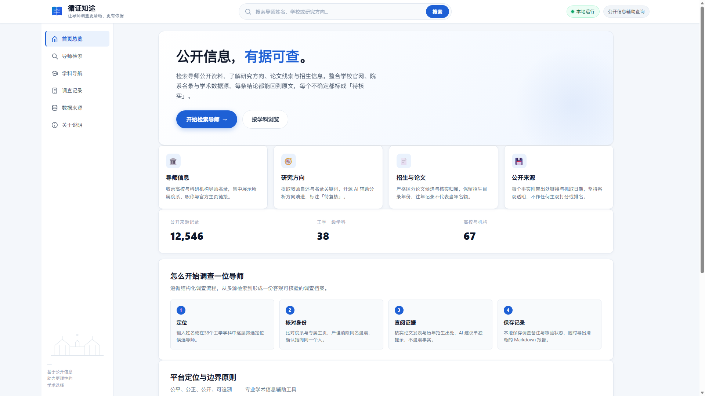
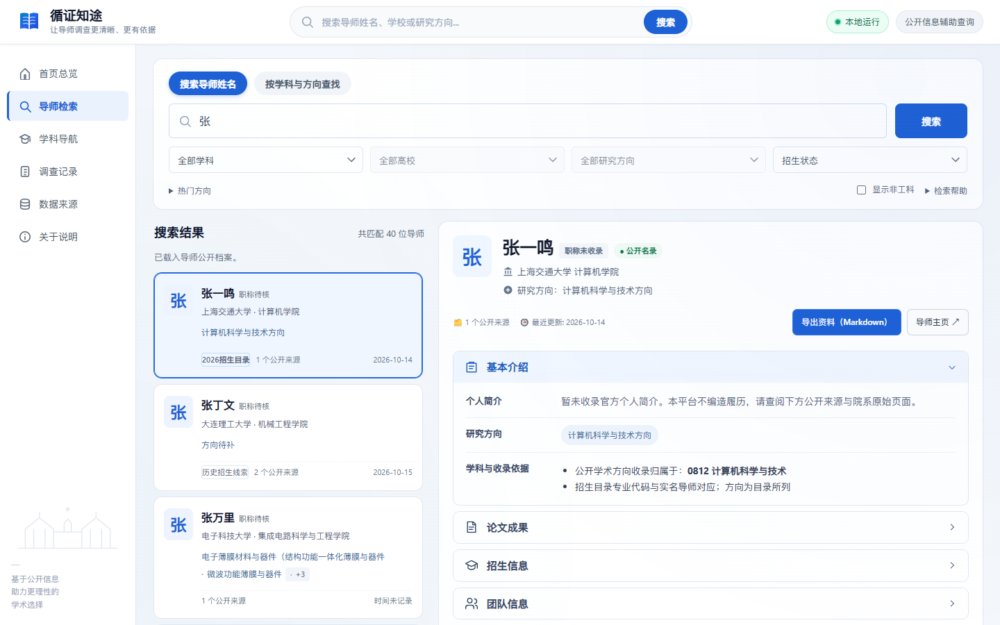
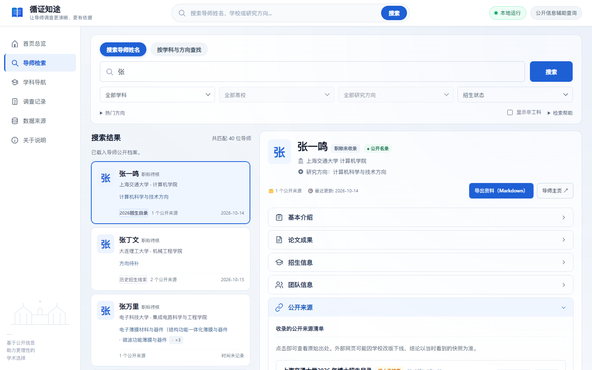
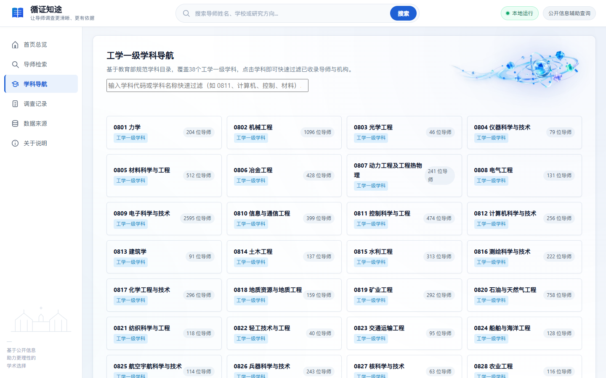
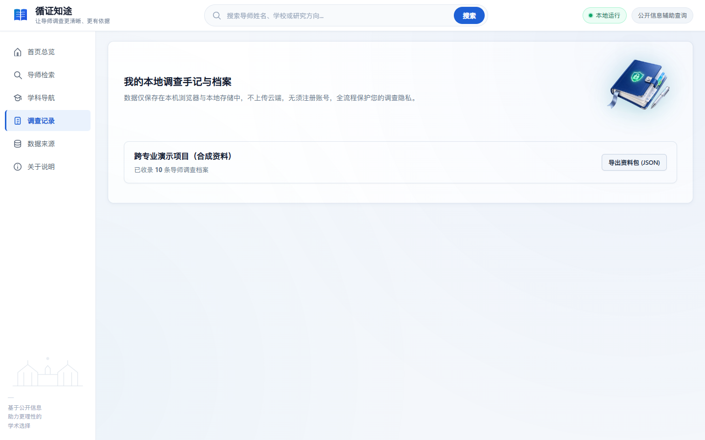
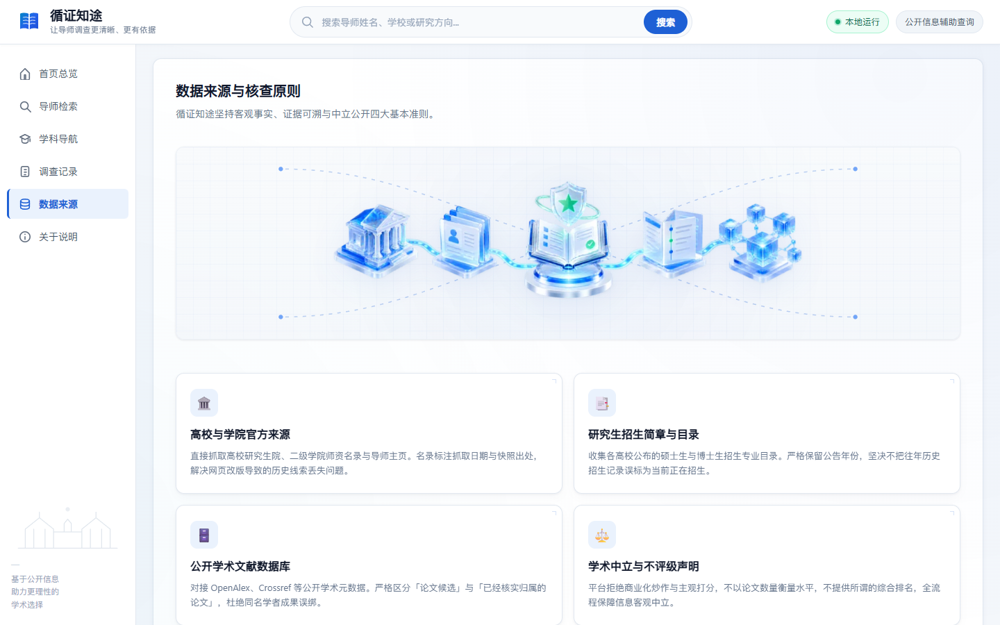
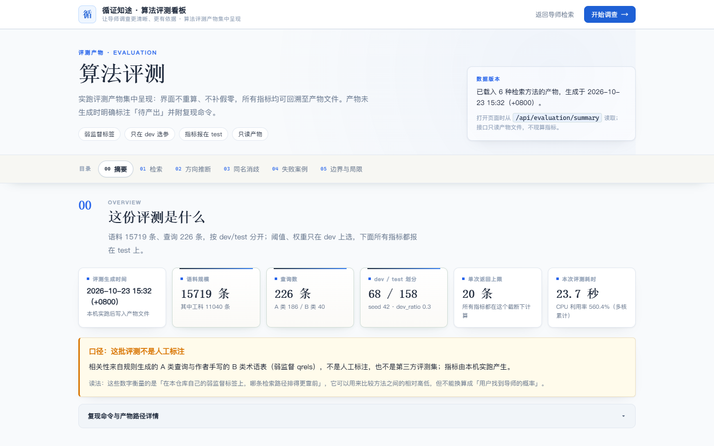

# 循证知途

[](LICENSE)
[](LICENSE-DATA)
[](workbench/requirements.txt)
[](workbench/tests)
[](CHANGELOG.md)
[](SECURITY.md)
[](CONTRIBUTING.md)

**循证知途是一个本地运行的导师公开信息查询与调查辅助工具。** 它面向学生与学术研究者，把「查一位老师」这件事拆成三步：先在公开来源里找到人，再核对该记录对应的是不是同一个人，最后把查到的证据和人工判断保存在本机。

它**不评价导师**：不排名、不打综合分、不预测读研体验，也不替你决定报考。它做的是把可核验的公开事实集中呈现，并明确标出哪些是官方来源、哪些是机器建议、哪些还没有证据。所有数据与调查记录都留在你自己的机器上。

> 本仓库同时保留了一份早期的集成电路专题静态报告产物（`reports/`、`data/processed/`）。那是历史阶段的产出，**不参与**当前工作台的检索与排序，其口径与局限见 [历史说明](docs/历史-集成电路专题.md)。

## 核心功能

| 能力 | 说明 |
|:--|:--|
| **按姓名查人** | 输入姓名后列出同名候选，逐条给出学校、院系、职称与主页，供你核对是不是要找的那位 |
| **按学科/高校/方向筛选** | 按 2022 年研究生教育一级学科导航，默认展示 38 个工学学科，可切换到非工科 |
| **公开来源追溯** | 每条记录都挂着来源 URL、抓取时间与来源类型（院系名录 / 个人主页 / 招生目录），可逐条回到原页面 |
| **同名身份核对** | 分「同一人 / 不同人 / 无法确认」三态；只有「同一专属主页 + 同机构」才判同一人，证据不足一律留在待核 |
| **论文线索** | 论文带 DOI、年份、期刊与作者位次，区分「候选归属」与「已核实归属」，不因同名作者就认定归属 |
| **招生资料** | 招生信息保留年份与原文出处，区分「本人表述」与「学院统一通知」，不把历史公告当成当前承诺 |
| **课题组公开信息观察** | 四个维度各自列公开事实，不给综合分、不加权、不排名、可点开看依据 |
| **本地调查记录** | 补充证据、记录人工核查状态、导出归档；文件锁 + 原子保存 + 损坏恢复 + 备份校验 |
| **检索** | 关键词 / BM25 / 向量语义 / 混合 / 自动策略五种模式；模型缺失时自动回落到 BM25 |
| **算法评测看板** | `/eval` 只读展示检索与推断的真实评测产物，标注哪些是程序复核、哪些是人工金标准 |

## 界面

> 以下为本机真实运行截图（统一 1440×900，Chromium 实际渲染，非设计稿）。评测页的数字来自仓库内的评测产物；本地档案页展示的是**合成演示资料**，不是任何真实调查记录。设计规范见 [docs/DESIGN.md](docs/DESIGN.md)。

| 首页总览 | 导师检索与档案 |
|:--:|:--:|
|  |  |
| **公开来源与证据核查**（每条事实带出处与「待人工核查」状态） | **学科导航**（38 个工学一级学科，按学科快速过滤） |
|  |  |
| **调查记录**（只存本机，可导出） | **数据来源与核验原则** |
|  |  |

**算法评测看板**（只读展示检索 / 方向推断 / 同名消歧的实测产物，并明确标注"这批评测不是人工标注"）：



## 项目特点：为什么这样设计

1. **证据先于结论。** 每条事实都要能追到某个公开页面。没有证据时字段是 `unknown`，**绝不写成 0**，也不折算成分数。
2. **三态而非二态。** 同名消歧不存在"非同一人即不同人"这种二分：证据不足就是 `unknown`，进人工待核，系统不自动合并任何记录。
3. **AI 产物与官方来源严格分离。** AI 建议单独存放在 `.workbench-data/`，逐条带分数与候选，**不覆盖原始字段**；界面上作为独立区块「AI 建议（待复核）」显示，并常驻一句"不构成事实、不会被自动写入"。
4. **离线可用是硬要求。** 平台主要在本机运行：向量模型缺失、加载失败或无法下载时，普通导师查询仍要正常工作，降级路径必须明确真实。
5. **隐私先于功能。** 不收录、不存储、不展示邮箱与电话；查询不离开本机；不需要任何在线大模型 API Key。
6. **可复现。** 需要模型的专项测试与快速测试分开；不用模型也能跑完业务测试与全部来源解析测试。

## 技术架构

```
workbench/
  app.py               FastAPI 应用与 38 个 API 路由；静态页面挂载；本地安全边界
  core.py              数据目录与项目读写入口；文本清洗（邮箱/电话在此处隐去）
  catalog.py           导师档案、学科/高校/方向索引与覆盖统计
  storage.py           本地调查记录的读写：文件锁 + 原子替换 + 损坏恢复
  investigation.py     调查记录、证据与人工核查状态
  relations.py         学术关系证据分层（L1 师承 / L2 共同指导 / L3 同门 / L4 共同署名）
  scope.py             学科范围（默认 38 个工学一级学科，可含非工科）
  search.py            关键词 / BM25 / 向量 / 混合 / 自动策略 + 索引缓存
  infer_directions.py  方向建议：关键词与嵌入分数级融合 + 低置信度拒绝
  disambiguate_names.py 同名消歧：证据分级 + 三态判定
  human_labels.py      人工标注的读取、校验与区分
  ai_hints.py          AI 建议区块的读取与呈现（与官方事实严格分开）
  public_research.py   公开来源抓取结果的解析与落盘（离线快照可复现）
  openalex.py          论文元数据（可选联网，失败不影响本地查询）
  sources/             53 个来源模块（每个对应一所学校的公开名录）
  collect_*.py         采集脚本族（离线跑，不参与运行期）
  reference/           随仓库分发的结构化档案与来源登记
  evaluation/          人工标注协议、检索标注协议、用户任务模板
  web/                 前端静态资源（HTML/CSS/JS/SVG/配图）
  tests/               单元测试与离线快照回归测试
  tools/               维护工具：数据质量、备份、编码体检、README 校验等
```

**数据分层**：`data/raw/` 下只有 24 个 `roster_*.json`（清洗后的官方名录，约 1.6 MB，**随仓库分发**）——抓到的网页原文不入库，采集脚本产物一律 gitignore；`workbench/reference/` 是随仓库分发的结构化档案与来源登记；`.workbench-data/` 是运行期档案、页面缓存与嵌入模型（已 gitignore）。**克隆后不联网也能运行**，因为逐人档案与页面快照已随仓库打包。

**API**：以 `/api/catalog/*` 为主（导师检索、档案、证据、论文、论文线索、AI 建议、覆盖统计），`/api/projects/*` 管理本地调查项目与检索。共 **38 个 API 路由**（GET 21 / POST 11 / PATCH 4 / DELETE 2），清单见 [docs/API.md](docs/API.md)。

**技术选型**：Python 3.12 + FastAPI + uvicorn；前端为原生静态页面，无构建步骤；向量检索用开源模型 [`BAAI/bge-small-zh-v1.5`](https://huggingface.co/BAAI/bge-small-zh-v1.5) 经 `fastembed` **本地推理**，不调用任何在线大模型 API。

## 环境要求

| 项 | 要求 |
|:--|:--|
| 操作系统 | Windows 10/11（主测环境）；Linux/macOS 需手动执行等价命令 |
| Python | 3.11 或以上（主测 3.12） |
| Node.js | 可选，仅在跑前端竞态测试时需要 ≥ 20 |
| 磁盘 | 仓库约 125 MB（git blob 合计）；运行期 `.workbench-data/` 另需约 200 MB（含嵌入模型缓存 91 MB，随采集与评测增长） |
| 网络 | **运行不需要网络**。首次安装依赖、首次下载嵌入模型时需要 |

## 安装

```bat
git clone https://github.com/logic202407-cmyk/ic-mentor-db.git
cd ic-mentor-db
py -3 -m venv .venv
.venv\Scripts\python.exe -m pip install -r workbench\requirements.txt
```

`workbench/requirements.txt` 刻意保持 **纯 ASCII**：pip 用系统区域编码读这个文件，中文注释会让 `pip install -r` 直接 `UnicodeDecodeError`。可选/开发用依赖（`markdown`、`pypdf`、`pypdfium2`、`pillow`、`pdfplumber`、`playwright`）列在文件末尾的注释里，运行工作台不需要它们。

## 运行

**一键启动**：双击根目录的 **`启动.cmd`**（英文系统用 `start.cmd`，内容相同）即可：

1. 若没有 `.venv`，自动创建并安装依赖（首次需要联网，几分钟）；
2. 启动本地服务并等到健康检查通过（最多等 20 秒）；
3. 自动打开浏览器到 <http://127.0.0.1:8765/>。

**停止**：关闭弹出的 **Mentor Workbench Server** 窗口，或双击 **`停止.cmd`**（`stop.cmd`）。

<details>
<summary>手动启动（等价命令）</summary>

```bat
.venv\Scripts\python.exe -m uvicorn workbench.app:app --host 127.0.0.1 --port 8765
```

健康检查：`curl http://127.0.0.1:8765/api/health`
</details>

启动脚本刻意写成**纯 ASCII**：`cmd.exe` 用 OEM 代码页解析 `.cmd`，把中文按 UTF-8 写进去会把行切坏（实测会出现 `'on.exe' 不是内部命令` 这类报错）。中文只留在**文件名**与文档里。

服务默认只监听 `127.0.0.1`，并校验 `Host` 与写请求的 `Origin`。这是本地工具，不含登录、账号与云端鉴权。

## 使用说明

1. **首页**选一级学科（默认工学 38 个）→ 选高校 → 选方向，或直接在顶部输入姓名；
2. 同名候选中**逐条核对学校与院系**，选定后进入导师档案；
3. 工作台左侧为导师列表，右侧为档案；基本介绍默认展开，论文成果、招生信息、团队信息与公开来源按需展开。团队保留关系与公开信息观察，公开来源内可保存证据、笔记和核查进度；
4. 在「公开来源证据」里点开任一来源回到原页面核对；
5. 把自己的核查结论记进「核查记录」，保存在本机；
6. 需要带走时导出调查记录（Markdown）。

“热门方向”可展开查看六个快捷入口，点击后自动切换至方向模式。该模式只匹配已收录的研究方向与学科字段（支持明确的中英文同义词），可与学科、高校、具体方向和历史招生线索条件组合；没有匹配数据时如实显示空状态，不以姓名或无关相似结果补位。

更有针对性的教程（指标怎么读、六步核对法、FAQ）见 **[docs/使用指南.md](docs/使用指南.md)**；口径与"不衡量什么"见 **[DISCLAIMER.md](DISCLAIMER.md)**。

**课题组公开信息观察不衡量学术水平、指导质量、课题组氛围与读研体验，也不构成报考建议。** 它不给综合分、不给权重、不做跨导师排名，只把四个维度的事实各自列出来：

- **署名结构**——学生一作占比。判定规则是「第一作者不是本校教师、且第一作者单位能匹配到本库内置的高校名单」，因此**这不是导师把一作让给学生的比例**；名单没覆盖的学校会被漏计，比例偏低而非偏高。
- **历史一作人数（累计，非在读）**——跨年份累加的不同第一作者姓名数。**不等于在读学生数，也不是课题组规模，不可横向比较。**
- **近三年可核实论文数**——只作为事实记录，不评价高低；数字小也可能只是我们没检索到。
- **信息公开度**——本人专属主页 / 研究方向 / 博导标注三项事实清单，不打分。

每个维度严格处于三种状态之一：有公开证据且值为 X、有公开证据且确为 0、**无公开证据**（记为 `unknown`，**绝不显示为 0**，也不折算成分数）。

**关系分析按证据强度分四级：**L1 明确师承（全库仅 27 条，有公开表述或学位指导记录支持）／L2 共同指导·长期合作／L3 同门／L4 共同署名。**只有 L1 可视为师承；共同署名一律不推定为师承。**

**范围：**默认只展示 **38 个工学一级学科**（2022 年目录 08 门类）；另有 79 个非工科学科的数据保留在库中、保留原 ID，可用界面「显示非工科」开关查看。

## 数据来源与证据原则

| 类别 | 来源 | 说明 |
|:--|:--|:--|
| 师资名录 | 各高校院系官网公开的教师名录页 | 姓名、职称、院系、所属单位；**不含邮箱与电话** |
| 个人主页 | 教师个人主页 / 课题组主页 | 研究方向、履历、招生表述原文 |
| 招生资料 | 院系发布的招生目录与年度公告 | **保留年份与出处**，区分本人表述与学院统一通知 |
| 论文元数据 | Crossref、OpenAlex 的公开接口 | 标题、作者、期刊/会议、年份、DOI；可用时标注作者机构 |
| 学科目录 | 2022 年研究生教育学科专业目录 | 一级学科编号与名称 |

**没有使用的数据**：任何需要登录、付费或绕过访问控制的内容（知网/万方全文、订阅期刊全文、需登录的基金与专利库等一律不涉及）。采集遵守公开可访问原则，设置请求间隔与并发上限。

**证据原则**（代码层面强制，不靠自觉）：

- **不因姓名相同就合并**导师；跨机构任职需保留时间与来源依据；
- **不因论文同名作者就归属**论文；区分「候选归属」与「已核实归属」；
- **不把历史招生线索当成当前招生承诺**；
- **不把 AI 生成的方向当成官方信息**；AI 结果单独存放、带分数、不覆盖原字段；
- 无证据时写 `unknown`，不写 0。

**当前进度（2026-10-23）：**全库 **15,719 条**记录（工学 38 个一级学科 **11,082 条**、公开来源 **12,546 条**、涉及 **67 所**高校或机构），来源模块 **53 个**、离线快照 **201 份**。

**关于覆盖均衡的一点说明：38 个工学学科的最大单一机构占比现已全部低于 60%。** 如果某学科 90% 的记录来自同一所学校，学生在上面看到的"不同学校导师"其实是同校几位老师，**跨校比较是假的**。所以我们把"最大单一机构占比 < 60%"定成硬标准，逐学科执行、逐学科公示。历史扩充过程（含被我们自己推翻的判断）见 [数据扩充记录](docs/数据扩充记录.md)。

**开源来源与致谢：**本项目的**导师调查方法论**参考了开源项目 **[Academic Detective · 学术侦探](https://github.com/yadnuses/Academic-Detective)**（MIT，官网 <https://www.academic-detective.top/>）的七步调查框架；`tools/skill_heuristics.py` 按原样调用其 `analysis.common_heuristics` 异常规则模块（通过 `ACADEMIC_SKILL_SCRIPTS` 环境变量指向其安装位置，未设置时安全跳过）。**本仓库未纳入该项目的任何代码**，工作台的调查档案、同名核对、课题组公开信息观察与关系分析均为本项目自行实现；工作台读入的同级目录 `academic-investigations/` 是该项目的产出，仅摘录其中的事实性内容，不继承其评分与评价。完整清单见 [开源及第三方资源使用清单](workbench/evaluation/records/开源及第三方资源使用清单.md)。

## 算法与可靠性

**检索**：`/api/projects/{id}/search` 支持五种 `mode`——`semantic`（向量语义）、`keyword`、`bm25`、`hybrid`（BM25 与向量各半）、`auto`。`auto` 对 `VLSI`、`MEMS`、`EDA` 这类英文缩写优先走 BM25——实测它们在中文嵌入模型里会坍缩成同一个向量；其余查询走混合检索。**向量模型缺失或加载失败时自动回落到 BM25**，结果里带 `fallback` 说明，不抛错、不返回空。

**方向建议**：关键词分与向量余弦做分数级融合（关键词 0.30 / 嵌入 0.70），并用**学科约束 + 校准后的融合阈值**做拒绝——达不到阈值的记录标 `unknown` 而不是硬给一个方向。融合权重只在 dev 划分上选择，test 划分独立复核，**改参数不许看测试集**。复现：

```bat
.venv\Scripts\python.exe -m workbench.infer_directions --validate 400 --ablate-text
```

**同名消歧**：只有「同一专属个人主页 + 同机构」才判 `same_person`；各有互不相同的专属主页且院系/学科冲突才判 `different_person`；缺主页、共用名录页、证据不足一律 `unknown` 并进人工待核。**专属主页判等优先于嵌入相似度**——同校履历模板化会让相似度虚高。复现：

```bat
.venv\Scripts\python.exe -m workbench.disambiguate_names --evaluate --gold
```

**人工金标准状态：待完成。** 标注协议、空白标注表与导入校验工具已备好（`workbench/evaluation/`），但**尚未收集到独立人工判断**，因此本项目**不报告任何人工准确率**；页面上出现的"规则复核一致率"是**两套程序规则之间的一致性**，不是人工金标准。

**AI 用在哪、不用在哪**：

| 用 AI | 做法 | 可核验 |
|:--|:--|:--|
| 按研究兴趣找导师 | 开源嵌入模型本地编码档案与查询，取余弦相似度 | `workbench/search.py`；向量带语料指纹缓存 |
| 方向补全 | 关键词分与向量余弦分数级融合，带消融与泄漏审计 | `workbench/infer_directions.py` |
| 同名待核提示 | 给人工复核排序，不自动合并 | `workbench/disambiguate_names.py` |

| 刻意不用 AI | 为什么 |
|:--|:--|
| 抓取与名录抽取 | 需要可复现、可审计：正则结果能逐条对照快照原文，生成式抽取不能 |
| 四级关系证据（L1–L4） | 需要确定性判定：师承一旦误判，后果比漏掉严重得多 |
| 同名导师核对 | 用"学校 + 院系"硬约束，宁可判"同名待核"也不猜 |

模型全部**本地运行**，不需要 Key、不产生调用费用、查询不离开本机。代价是语义能力受这个小模型限制。

## 测试与复现

测试用标准库 `unittest`，不需要 pytest。

```bat
:: 全部业务测试（不需要向量模型，约 3–6 分钟，随用例数增长）
.venv\Scripts\python.exe -m unittest discover -s workbench/tests

:: 只跑某一组
.venv\Scripts\python.exe -m unittest workbench.tests.test_storage_safety -v
```

| 测试分层 | 内容 | 是否需要模型 |
|:--|:--|:--|
| 快速校验 | 编码体检、README 徽章、数据文件可解析、编译检查 | 否 |
| 全部业务测试 | 56 个测试模块，覆盖存储、安全、检索、消歧、来源解析、前端契约 | 否 |
| 模型专项 | 需要向量模型的语义检索与方向推断用例 | 是，本地已有模型缓存时才跑 |

**CI**：`.github/workflows/validate.yml` 分三个 job——`validate`（旧专题数据与 HTML 产物校验）、`workbench`（零重依赖的轻量检查）、`full`（完整 Python 测试 + 前端竞态测试 + 事实一致性 + 数据质量报告）。**CI 刻意不安装 `fastembed`/`onnxruntime`**——那是几百 MB，模型相关测试只在本地跑，避免 CI 因下载模型而不稳。

**关键数字由检查钉住，而不是靠人记得更新**：README 徽章与体积表由 `python -m workbench.tools.check_readme_badges` 校验（`--fix` 可就地改正），对外数字由 `python -m workbench.tools.check_facts_consistency` 钉到实际数据上。

**数据质量报告**（只读、不联网、不改数据）：

```bat
.venv\Scripts\python.exe -m workbench.tools.data_quality
```

生成 [reports/data-quality.md](reports/data-quality.md)：记录 ≠ 自然人（同名组、主页类型分布）、论文/招生/关系覆盖、缺失字段与采集月份。

## 参与贡献

最欢迎的是**信息更正**——如果你是名单中的老师，或发现某条信息有误：

- 提 [Issue](https://github.com/logic202407-cmyk/ic-mentor-db/issues/new)（**无需提供任何证件**）；
- 可申请更正信息、移除整条记录、移除主页链接；
- **我们承诺 7 个工作日内处理**。

其他贡献方式（新增一所学校、新增一个来源模块、补测试）见 [CONTRIBUTING.md](CONTRIBUTING.md)。

| 你可能想找 | 去处 |
|:--|:--|
| 怎么启动 | 本文件「运行」一节，或双击 `启动.cmd` |
| 怎么贡献 | [CONTRIBUTING.md](CONTRIBUTING.md) |
| 报告隐私或安全问题 | [SECURITY.md](SECURITY.md)（**请走私密渠道**） |
| 行为准则 / 删除申请 | [CODE_OF_CONDUCT.md](CODE_OF_CONDUCT.md) |
| 版本变化 | [CHANGELOG.md](CHANGELOG.md) |
| 怎么引用 | [CITATION.cff](CITATION.cff) |
| 口径与不衡量什么 | [DISCLAIMER.md](DISCLAIMER.md) |
| 接口清单 | [docs/API.md](docs/API.md) |
| 维护者上手 | [docs/维护指南.md](docs/维护指南.md)、[docs/开发审计记录](docs/development-audit.md) |
| 第三方方法与资源 | [开源及第三方资源使用清单](workbench/evaluation/records/开源及第三方资源使用清单.md) |

## 开源许可

| 范围 | 许可 |
|:--|:--|
| 代码（`workbench/`、`tools/`） | [MIT](LICENSE) |
| 本项目原创的数据整理与文字材料（`data/`、`docs/`、`reports/` 等） | [CC BY-NC-SA 4.0](LICENSE-DATA)（**非商业性使用**） |

`LICENSE-DATA` **不覆盖第三方网页原文**：抓取到的页面内容版权归原站点所有，本仓库只保存用于核验的结构化事实与链接。公开引用本项目数据或图表时，请注明来源并附免责声明。引用格式见 [CITATION.cff](CITATION.cff)。

## 体积说明

工程**能跑起来所需的最小集合**与仓库体积是两回事，分开记：

| 项目 | 体积 | 说明 |
|:--|--:|:--|
| 纳入 git 的文件（678 个） | **约 114 MB** | 按 git blob 大小统计（与平台无关）；大头是数据本体，见下方明细 |
| `.git` | 约 81 MB | 历史提交 |
| `.venv` | 约 211 MB | 虚拟环境，可由 `requirements.txt` 重建 |
| `data/raw` | 约 1.6 MB | 只有 24 份清洗后的 `roster_*.json`（**随仓库分发**）；抓到的网页原文不入库 |
| `.workbench-data/` | 约 200 MB | 运行期档案、页面缓存与嵌入模型，已 gitignore；随采集与评测增长 |

**最大的几个文件**：

| 文件 | 体积 | 是什么 |
|:--|--:|:--|
| `data/processed/mentor_ranked.json` | 32.8 MB | 历史集成电路专题的语料与文献计量 |
| `workbench/reference/admission_faculty.json` | 17.6 MB | 招生目录与院系对应 |
| `workbench/reference/engineering_scale_faculty.json` | 9.7 MB | 工学各学科名录快照 |
| `workbench/reference/research/dossiers.json.gz` | 5.2 MB | **逐人档案打包**（clone 后界面靠它才有论文与招生记录） |
| `workbench/reference/research_sources.json` | 3.5 MB | 来源登记表 |
| `workbench/reference/ai/direction_suggestions.json` | 4.5 MB | **AI 方向建议产物**（clone 后「AI 建议」区块靠它） |

> 表中体积按 1024 进制换算（即 MiB），与前两张表口径一致；前两列由 `workbench.tools.check_readme_badges` 自动校验（`--fix` 可就地改正）——这几个数字曾经与实际差了一大截，而没有人会去更新它们。

**已做的瘦身**：删掉了可重生成的页面缓存与一次性侦察目录，释放 **372 MB**。这些删掉后应用功能不变——档案数据在 `.workbench-data/public-research/`，与页面缓存是两回事。
**刻意保留**：`data/raw`（网页原文）是"数据可核验"的底稿，删了就无法回溯某条记录来自哪个页面；它已被 gitignore，不影响仓库体积。`.workbench-data/models/` 是语义检索的嵌入模型缓存，删掉会在首次检索时重新下载。

## 已知限制

请把这一节读完再判断任何一条数据。

1. **覆盖不均衡仍未完全消除。** 最大单一机构占比已全部低于 60%，但部分学科只有 2–3 所机构，跨校比较的意义有限；学科条目数小的（如数十条）只表示"我们核验到的"，不表示全国设点情况。
2. **同名污染与漏检无法根除。** 中文拼音重名严重，含同校内重名。已做"姓名 + 机构"双条件校验，仍会有漏检与疑似混入；标记"同名待核""低置信"的记录**请以官方主页为准**。
3. **论文归属是线索不是定论。** 存在"候选归属"与"已核实归属"之分；Crossref/OpenAlex 对会议论文的作者机构字段收录不完整，会**系统性低估**顶会产出；中文期刊完全未覆盖。
4. **招生信息有时效性。** 平台保留公告年份与原文出处，但**历史公告不等于当前承诺**，实际名额以导师回复与院系最新通知为准。
5. **方向缺失是常态而非缺陷。** 大量来源页根本不写研究方向；达不到阈值时平台标 `unknown`，不用推测填空。
6. **AI 只是辅助。** 向量模型对长尾细分方向区分度有限，语料以中文为主、英文查询效果下降；**语义相似度不代表"这位导师适合你"**。
7. **人工金标准尚未建立。** 同名消歧与检索相关性的人工标注协议已备好但**尚未完成标注**，因此不报告人工 Precision/Recall，也不报告用户任务成功率。
8. **不衡量指导质量。** 导师性格、组会风格、补助待遇、毕业去向、是否允许实习等**文献与网页数据里没有**，必须向在读/毕业学生核实。
9. **本仓库含历史阶段的集成电路专题产物。** `reports/` 与 `data/processed/mentor_ranked.*` 是早期静态报告，含旧口径的文献计量分值，**不参与**当前工作台的检索与排序，也不代表当前项目的任何能力；其局限见 [历史说明](docs/历史-集成电路专题.md)。
10. **仅主测 Windows。** Linux/macOS 可运行但未做完整验证；`.cmd` 脚本仅 Windows 可用，其他平台请用手动命令。
